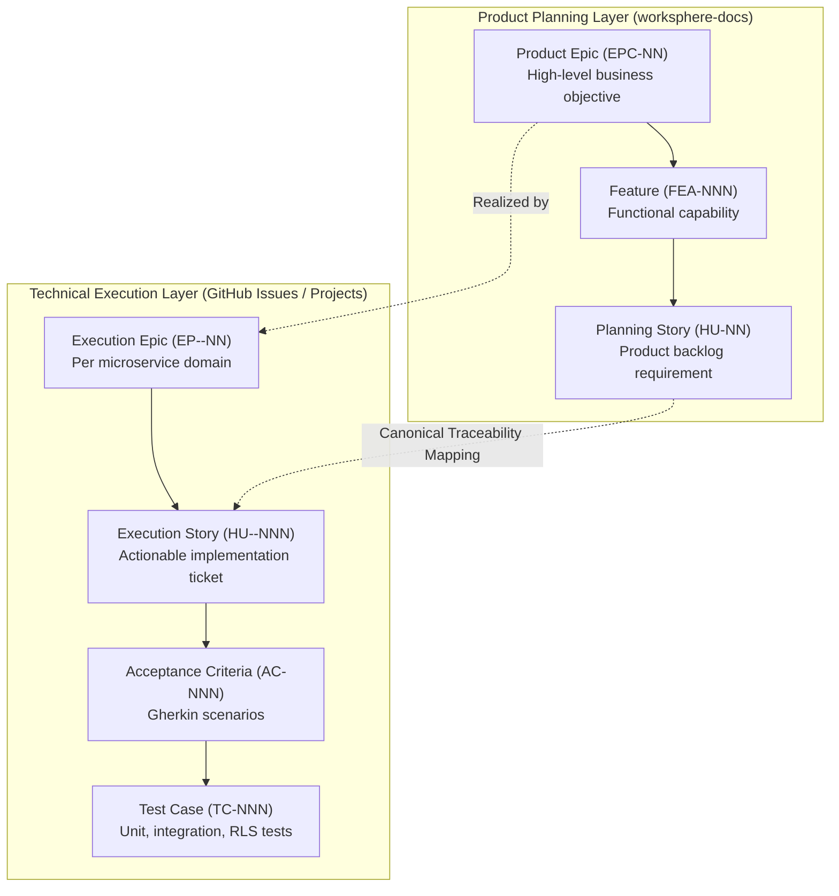

# 00 — Agile Conventions & Artifact Nomenclature

> **Status:** 🟢 Stable  
> **Last Updated:** 2026-11-15  
> **Technical Lead & Architect:** Daniel (`daniel2004-lsd`)  
> **Project:** WorkSphere — Enterprise Operations Intelligence Platform  
> **Scope:** Naming, structuring, and bidirectional traceability between product planning and technical execution

---

## 1. Two-Layer Artifact Hierarchy

WorkSphere maintains a strict separation between the **Product Planning Layer** and the **Technical Execution Layer**, linked by explicit traceability rules:

---

## 2. Naming Conventions

### 2.1. Microservice Prefixes (`<MICRO>`)
For the execution layer, each microservice domain is identified by a standardized uppercase prefix:

| Prefix `<MICRO>` | Target Repository | Scope |
|---|---|---|
| **`IAM`** | `worksphere-iam-service` | Keycloak, OIDC, RBAC, Tokens |
| **`TENANT`** | `worksphere-tenant-service` | Organizations, Memberships, Invitations |
| **`WORKSPACE`** | `worksphere-workspace-service` | Projects, Boards, Tasks, Operational Blockers |
| **`WORKFLOW`** | `worksphere-workflow-service` | Approval State Machines, Audit Logs |
| **`BILLING`** | `worksphere-billing-service` | SaaS Plans, Subscriptions, Usage Limits |
| **`NOTIF`** | `worksphere-notification-service` | Outbound Emails, In-App Alerts, Webhooks |
| **`FILE`** | `worksphere-file-service` | S3 / MinIO Object Storage, Presigned URLs |
| **`ANALYTICS`** | `worksphere-analytics-service` | ClickHouse OLAP, Metrics & Local AI Summaries |
| **`WEB`** | `worksphere-web` | React 18 + Vite + TypeScript Frontend |

---

### 2.2. Product Epics (`EPC-NN`)
- **Format:** `EPC-NN: Descriptive Title`
- Focuses on **business goals**, never on underlying frameworks or technical implementations.

### 2.3. Execution Epics (`EP-<MICRO>-NN`)
- **Format:** `EP-<MICRO>-NN: Title`
- Scoped to an individual service boundary (e.g., `EP-TENANT-01`, `EP-WORKSPACE-01`).

### 2.4. Features (`FEA-NNN`)
- **Format:** `FEA-NNN: Title`
- Groups related user journeys within a single product epic.

### 2.5. User Stories (HU)
- **Planning Layer:** `HU-NN` in product documentation.
- **Execution Layer:** `HU-<MICRO>-NNN` in code repositories and issue boards.
- **Title Structure:** `[Infinitive verb] + [Target entity] + [Optional context]` (e.g., `HU-WORKSPACE-003: Block task when requiring operational approval`).

---

## 3. Defect Severity Matrix

| Severity | Level | Resolution SLA & Criterion |
|:---:|---|---|
| **P0** | Blocker / Critical | Release-blocking defect, cross-tenant data leakage, or security breach — immediate hotfix required. |
| **P1** | High | Core functional impairment — must be resolved within the active sprint. |
| **P2** | Medium | Minor issue or enhancement — prioritized for the next sprint. |
| **P3** | Low | Minor cosmetic issue or low-priority technical debt — scheduled without urgency. |

---

## 4. User Story Lifecycle States

| State | Description | Responsible Role |
|---|---|---|
| **Backlog** | Identified requirement pending detailed refinement. | Product Owner / Architect |
| **Refinement** | Active technical breakdown, contract definition, and rule modeling. | Product + Engineering |
| **Ready** | Meets all **Definition of Ready (DoR)** criteria; ready for implementation. | Team Consensus |
| **In Progress** | Assigned to an engineer; active development on a `feat/` branch. | Engineer |
| **In Review** | Pull Request opened with complete tests; awaiting code review. | Peer Reviewer / Architect |
| **In QA** | Deployed to QA environment; executing integration and RLS tests. | QA Engineer |
| **Done** | Meets all **Definition of Done (DoD)** criteria; merged into `main`. | Tech Lead |
| **Cancelled** | Discarded due to scope changes or architectural updates. | Product Owner |
