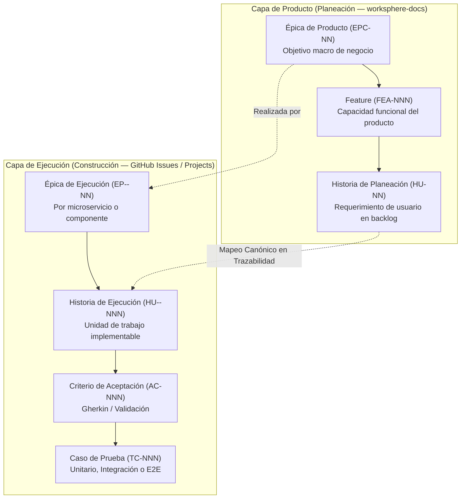

# 00 — Convenciones Ágiles y Nomenclatura de Artefactos

> **Estado:** 🟢 Estable  
> **Última actualización:** 2026-11-15  
> **Líder Técnico & Arquitecto:** Daniel (`daniel2004-lsd`)  
> **Proyecto:** WorkSphere — Enterprise Operations Intelligence Platform  
> **Propósito:** Definir formalmente cómo nombrar, estructurar, trazar y referenciar los artefactos ágiles del proyecto entre la capa de producto (documentación en este repositorio) y la capa de ejecución (GitHub Issues & Projects).

---

## 1. Jerarquía de Artefactos de Dos Capas

WorkSphere separa estrictamente la **Capa de Producto (Planeación)** de la **Capa de Ejecución (Construcción)**, vinculándolas mediante reglas de trazabilidad explícitas:

### Regla Puente:
- Cada **Épica de Ejecución (`EP-<MICRO>-NN`)** realiza una o más **Épicas de Producto (`EPC-NN`)**.
- Cada **Historia de Ejecución (`HU-<MICRO>-NNN`)** traza a su Requisito Funcional (`RF-*`) y, cuando aplique, a su historia de planeación (`HU-NN`).
- El mapeo canónico vive en [`04-requirements/traceability-matrix.md`](../04-requirements/traceability-matrix.md).

---

## 2. Convenciones de Nomenclatura (Naming)

### 2.1. Prefijos de Microservicios (`<MICRO>`)
Para la capa de ejecución, cada microservicio se identifica en mayúsculas sin sufijos:

| Prefijo `<MICRO>` | Microservicio Correspondiente | Responsabilidad |
|---|---|---|
| **`IAM`** | `identity-access` | Autenticación, OIDC, RBAC, Keycloak |
| **`TENANT`** | `tenant-management` | Organizaciones, membresías, invitaciones |
| **`WORKSPACE`** | `workspace-service` | Proyectos, tableros, tareas, comentarios |
| **`WORKFLOW`** | `workflow-service` | Procesos de aprobación, reglas, máquinas de estado |
| **`BILLING`** | `billing-service` | Planes, suscripciones, cuotas |
| **`NOTIF`** | `notification-service` | Emails, alertas in-app, webhooks |
| **`FILE`** | `file-service` | Almacenamiento MinIO (S3), metadatos |
| **`ANALYTICS`** | `analytics-service` | ClickHouse OLAP, métricas y reportes |
| **`WEB`** | `apps/web` | Frontend React + TypeScript |
| **`INFRA`** | `infrastructure` | Docker Compose, Kong Gateway, RabbitMQ |

---

### 2.2. Épicas de Producto
- **Formato:** `EPC-NN: Título descriptivo`
- `NN`: Secuencial continuo global (`EPC-01`, `EPC-02`, etc.).
- El título describe el **objetivo de negocio**, nunca la solución técnica.
- Residen en la capa de producto ([`03-product/product-backlog.md`](../03-product/product-backlog.md)).

| Ejemplo Válido ✅ | Ejemplo Inválido ❌ |
|---|---|
| `EPC-01: Aislamiento y Gestión de Organizaciones Inquilinas` | `EPIC-1: Microservicio Tenant y Base de Datos` |
| `EPC-02: Seguimiento de Proyectos y Tareas Críticas` | `EPC-2: Backend de Workspace` |
| `EPC-03: Gobernanza y Aprobaciones Operativas` | `EPC-03: endpoints de workflow` |

---

### 2.3. Épicas de Ejecución
- **Formato:** `EP-<MICRO>-NN: Título`
- `<MICRO>`: Prefijo oficial del componente (ver tabla 2.1).
- `NN`: Secuencial por microservicio (`EP-TENANT-01`, `EP-WORKSPACE-01`, etc.).
- Residen como issues/milestones en el repositorio y tablero de ejecución.

| Ejemplo Válido ✅ | Ejemplo Inválido ❌ |
|---|---|
| `EP-TENANT-01: tenant-service (gestión de organizaciones y outbox)` | `EP-TENANT (sin número secuencial)` |
| `EP-WORKFLOW-01: workflow-service (máquina de estados de aprobación)` | `EPC-WORKFLOW-01 (mezcla capa de producto y técnica)` |

---

### 2.4. Features
- **Formato:** `FEA-NNN: Título`
- Agrupan requerimientos e historias funcionales dentro de una épica de producto.
- `NNN`: Secuencial numérico de tres dígitos (`FEA-001`, `FEA-002`, etc.).

---

### 2.5. Historias de Usuario (HU)
Las Historias de Usuario tienen identificadores diferenciados según su propósito:

1. **Planeación (Producto):** `HU-NN` — ID de requerimiento funcional en backlog documental ([`04-requirements/user-stories.md`](../04-requirements/user-stories.md)).
2. **Ejecución (Construcción):** `HU-<MICRO>-NNN` — ID canónico de implementación técnica en el repositorio de código y GitHub Issues.

- **Estructura del Título:** `[Verbo en infinitivo] + [Objeto] + [Contexto opcional]`

| Ejemplo Válido ✅ | Ejemplo Inválido ❌ |
|---|---|
| `HU-TENANT-001: Registrar organización con validación de slug y outbox` | `HU-1: Módulo organizaciones` |
| `HU-WORKSPACE-002: Bloquear tarea al requerir aprobación operativa` | `HU-WORK-02: Tareas en backend` |
| `HU-WORKFLOW-001: Procesar decisión de aprobación con historial inmutable` | `HU-3: Aprobaciones` |

---

### 2.6. Criterios de Aceptación y Casos de Prueba
- **Criterios de Aceptación:** `AC-NNN` (redactados en formato Given-When-Then / Gherkin, ligados a su HU).
- **Casos de Prueba:** `TC-NNN` (pruebas unitarias, de integración o de aislamiento multi-tenant en `11-quality/`).

---

## 3. Matriz de Severidad de Defectos (Bugs)

| Severidad | Nivel | Descripción y Criterio de Atención |
|:---:|---|---|
| **P0** | Crítico / Blocker | Bloquea el release o vulnera el aislamiento multi-tenant — corrección inmediata requerida. |
| **P1** | Alta | Defecto funcional importante en un flujo de valor — debe resolverse en el sprint actual. |
| **P2** | Media | Fallo menor o mejora que no impide la operación — priorizable para el siguiente sprint. |
| **P3** | Baja | Deuda técnica leve o detalle estético — se agenda en backlog sin urgencia. |

---

## 4. Ciclo de Vida y Estatus de Historias de Usuario

| Estatus | Descripción del Estado | Quién es Responsable de Avanzarlo |
|---|---|---|
| **Backlog** | Requerimiento identificado, sin análisis detallado ni criterios de aceptación. | Product Owner / Arquitecto |
| **Refinamiento** | En análisis activo con el equipo técnico; definición de contratos y precondiciones. | Producto + Desarrollo |
| **Listo (Ready)** | Cumple con el **Definition of Ready (DoR)**: especificada, estimada y aprobada para iniciar. | Equipo Completo |
| **En desarrollo** | Asignada a un desarrollador o agente de código; trabajo activo en branch `feat/`. | Desarrollador / Agente |
| **En revisión** | Pull Request abierto con código completo, esperando Code Review y revisión de pares. | Revisor Técnico / Arquitecto |
| **En QA** | Validación en entorno de staging; ejecución de tests de integración y verificación RLS. | QA Engineer / Verifier |
| **Hecho (Done)** | Cumple con el **Definition of Done (DoD)**: testeada, documentada y mergeada en `main`. | Product Owner / Tech Lead |
| **Cancelada** | Descartada por cambio de alcance, redundancia o decisión de arquitectura. | Producto |

> [!IMPORTANT]
> - Una HU **no puede pasar a Listo** sin cumplir el [`00-governance/definition-of-ready.md`](./definition-of-ready.md).
> - Una HU **no puede pasar a Hecho** sin cumplir el [`00-governance/definition-of-done.md`](./definition-of-done.md).

---

## 5. Trazabilidad Bidireccional

Cada Historia de Ejecución (`HU-<MICRO>-NNN`) debe ser trazable hacia:

| Desde | Hacia | Ubicación de la Evidencia |
|---|---|---|
| `HU-<MICRO>-NNN` | Épica de Ejecución (`EP-<MICRO>-NN`) | GitHub Issue (Milestone / Parent Epic) |
| `HU-<MICRO>-NNN` | Épica de Producto (`EPC-NN`) | Matriz de Trazabilidad (`04-requirements/traceability-matrix.md`) |
| `HU-<MICRO>-NNN` | Feature (`FEA-NNN`) | Backlog de Producto (`03-product/product-backlog.md`) |
| `HU-<MICRO>-NNN` | Requisito Funcional (`RF-*`) | Especificación de Requerimientos (`04-requirements/functional.md`) |
| `HU-<MICRO>-NNN` | Caso de Prueba (`TC-NNN`) | Estrategia de Calidad (`11-quality/testing-strategy.md`) |
| `HU-<MICRO>-NNN` | Decisión Arquitectónica (`ADR-*`) | Registro de Decisiones (`05-architecture/decisions/`) |
