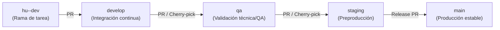

# 00 — Convenciones de Git y Estrategia de Ramas

> **Estado:** 🟢 Estable  
> **Última actualización:** 2026-11-15  
> **Líder Técnico & Arquitecto:** Daniel (`daniel2004-lsd`)  
> **Proyecto:** WorkSphere — Enterprise Operations Intelligence Platform  
> **Propósito:** Definir el modelo de branching, ciclo de Pull Requests, Conventional Commits y reglas de aprobación para el repositorio de documentación (`worksphere-docs`) y los repositorios de código/infraestructura.

---

## 1. Alcance: Dos Modelos de Ramas según el Tipo de Repositorio

| Tipo de Repositorio | Repositorios del Ecosistema | Modelo de Ramas | Ambientes |
|---|---|---|---|
| **Documental (`-docs`)** | `worksphere-docs` (Fuente Única de Verdad) | **Solo `main`**. Ramas efímeras para cambios. | No maneja ambientes. |
| **Código / Monorepo (`worksphere`)** | `worksphere` (Backends, Frontend, Infra, DB) | **Flujo Promocional de Ambientes**: `develop` → `qa` → `staging` → `main`. | 4 ambientes formales. |

---

## 2. Modelo A: Repositorio Documental (`worksphere-docs`)

El repositorio de documentación es la **Fuente Única de Verdad (SSOT)**. Vive siempre en `main` y no se promueve entre ambientes.

### Flujo de Cambio Documental:
1. Crear una rama efímera desde `main`:
   - `feat/doc-<descripcion>`: Para documentos nuevos.
   - `fix/doc-<descripcion>`: Para corrección de contenido erróneo.
   - `chore/doc-<descripcion>`: Para reorganización, imágenes o renombrados.
   - `docs/doc-<descripcion>`: Para actualización de documentos existentes.
2. Realizar commits atómicos y claros en inglés siguiendo Conventional Commits.
3. Subir la rama (`git push origin <rama-efimera>`).
4. Abrir Pull Request hacia `main`.
5. Revisar, resolver comentarios y mergear mediante **Squash and Merge**.
6. Eliminar la rama efímera una vez fusionada.

> [!NOTE]
> En `worksphere-docs` **no existen ramas `develop`, `qa` ni `staging`**. Nunca se hace commit directo a `main` sin PR.

---

## 3. Modelo B: Repositorios de Código (`worksphere`)

En el repositorio de código y sus servicios, las ramas principales representan ambientes y están **estrictamente protegidas**:



| Rama Base | Propósito | Regla de Recepción |
|---|---|---|
| **`develop`** | Integración del trabajo activo de desarrollo. | Recibe Pull Requests desde ramas hijas `hu-<numero>-dev` o `feat/*`. |
| **`qa`** | Pruebas de integración, verificación de RLS y QA. | Recibe PRs o cherry-picks aprobados desde `develop`. |
| **`staging`** | Preproducción y validación final previa al release. | Recibe PRs o cherry-picks aprobados desde `qa`. |
| **`main`** | Producción y código estable en operación. | Recibe únicamente PRs desde ramas de release (`release/iteration-NN`). |

---

## 4. Nomenclatura de Ramas por Historia de Usuario (Capa de Ejecución)

Para garantizar trazabilidad absoluta con el tracker de GitHub:

| Caso de Uso | Rama Base | Formato Canónico | Ejemplo |
|---|---|---|---|
| **Desarrollo de HU** | `develop` | `hu-<numero>-dev` | `hu-01-dev` |
| **Ajuste o Validación QA** | `qa` | `hu-<numero>-qa` | `hu-01-qa` |
| **Validación en Staging** | `staging` | `hu-<numero>-staging` | `hu-01-staging` |
| **Release de Iteración** | `main` | `release/<iteracion>` | `release/iteration-01` |

---

## 5. Procedimiento de Promoción entre Ambientes

### 5.1. Flujo hacia `develop`
```bash
git checkout develop
git pull origin develop
git checkout -b hu-01-dev
# ... realizar cambios y pruebas ...
git add <archivos>
git commit -m "feat(tenant): implement organization outbox pattern"
git push origin hu-01-dev
# Abrir PR hacia develop
```

### 5.2. Flujo hacia `qa`
```bash
git checkout qa
git pull origin qa
git checkout -b hu-01-qa
git merge origin/hu-01-dev  # o git cherry-pick <commit-sha>
git push origin hu-01-qa
# Abrir PR hacia qa
```

### 5.3. Flujo hacia `staging`
```bash
git checkout staging
git pull origin staging
git checkout -b hu-01-staging
git merge origin/hu-01-qa
git push origin hu-01-staging
# Abrir PR hacia staging
```

### 5.4. Release hacia `main` (Producción)
```bash
git checkout main
git pull origin main
git checkout -b release/iteration-01
git cherry-pick <commit-sha-1>
git cherry-pick <commit-sha-2>
git push origin release/iteration-01
# Abrir PR de release hacia main
```

---

## 6. Convención de Mensajes de Commit (Conventional Commits)

### 6.1. Formato para Repositorio Documental (`worksphere-docs`)
```
<type>(NN-section): short description in English
```

**Tipos permitidos en docs:**
- `docs`: Crear o actualizar contenido documental.
- `fix`: Corregir errores conceptuales, contratos o erratas.
- `chore`: Mover, renombrar, reordenar o actualizar metadatos/diagramas.
- `refactor`: Reestructurar secciones sin alterar el significado de fondo.

> [!CAUTION]
> En `worksphere-docs` **no se permite** el uso de `feat`, `test`, `build` ni `ci`.

**Ejemplos válidos:**
- `docs(01-context): add problem framing and context blindness analysis`
- `docs(03-product): define MVP essential triad product vision`
- `docs(06-data): add official Liquibase governance standards`
- `chore(00-governance): update git conventions and branch models`

### 6.2. Reglas de Calidad para Commits
1. **Descripción en inglés:** El título y descripción del commit va siempre en idioma inglés.
2. **Contenido en español:** El cuerpo de los documentos y especificaciones de negocio se redacta en español neutro.
3. **Atomicidad:** Commits pequeños y trazables a un único artefacto o microservicio.
4. **No mezclar contextos:** Prohibido agrupar cambios funcionales de diferentes dominios sin relación directa.

---

## 7. Políticas de Revisión y Aprobación de Pull Requests

### Reglas de GitHub Branch Protection:
1. **Mínimo de Aprobaciones:** Todo PR requiere al menos 2 aprobaciones de revisores técnicos para fusionarse.
2. **Resolución de Hilos:** Todos los comentarios de revisión deben estar explícitamente resueltos.
3. **Descarte por Nuevos Cambios:** Si se hace un push nuevo al PR, las aprobaciones previas se invalidan automáticamente.
4. **Prohibición de Force-Push y Eliminación:** Protegidas contra force-push en ramas padre (`main`, `develop`, `qa`, `staging`).
5. **Regla de Oro:** Todo cambio en código **debe existir previamente en docs** (decisión ADR o especificación) y tener su HU trazada en el backlog. Si no existe, primero se aprueba la documentación.

---

## 8. Procedimiento de Hotfix en `main`

Si se detecta un fallo crítico o ruptura en `main` que no puede esperar el ciclo regular de release:

```bash
git checkout main
git pull origin main
git checkout -b fix/doc-broken-contract
# ... corregir el fallo ...
git add <archivos>
git commit -m "fix(07-api): correct broken path in tenant openapi contract"
git push origin fix/doc-broken-contract
# Abrir PR hacia main y mergear.
```

Una vez fusionado en `main`, el commit se propaga hacia atrás hacia `staging`, `qa` y `develop` mediante `cherry-pick`:
```bash
git checkout develop
git pull origin develop
git cherry-pick <commit-sha-hotfix>
git push origin develop
```
