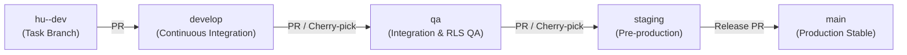

# 00 — Git Conventions, Branching Strategy & Environment Flow

> **Status:** 🟢 Stable  
> **Last Updated:** 2026-11-15  
> **Technical Lead & Architect:** Daniel (`daniel2004-lsd`)  
> **Project:** WorkSphere — Enterprise Operations Intelligence Platform  
> **Scope:** Branching lifecycle, Pull Request approvals, and commit conventions across all ecosystem repositories

---

## 1. Dual-Model Branching Strategy by Repository Type

| Repository Type | Target Repositories | Branching Model | Environments |
|---|---|---|---|
| **Documentation (`-docs`)** | `worksphere-docs` (Single Source of Truth) | **`main` Only**. Ephemeral branches for PRs. | No environments. |
| **Service Repositories (`*-service`)** | `worksphere-tenant-service`, `worksphere-workspace-service`, etc. | **Promotional Environment Flow**: `develop` → `qa` → `staging` → `main`. | 4 formal environments. |
| **Database Repositories (`*-db`)** | `worksphere-tenant-db`, `worksphere-workspace-db`, etc. | **Promotional Environment Flow**: `develop` → `qa` → `staging` → `main`. | 4 formal environments (Liquibase updates). |

---

## 2. Model A: Documentation Repository (`worksphere-docs`)

The documentation repository is the **Single Source of Truth (SSOT)**. It lives permanently on `main` and is never promoted across environments.

### Ephemeral Branch Workflow:
1. Create an ephemeral branch off `main`:
   - `feat/doc-<description>`: For new documentation files.
   - `fix/doc-<description>`: For correcting inaccuracies or broken links.
   - `chore/doc-<description>`: For reorganization, diagrams, or metadata updates.
   - `docs/doc-<description>`: For expanding existing specifications.
2. Commit small, atomic changes in English following Conventional Commits.
3. Push the ephemeral branch and open a Pull Request towards `main`.
4. Review, resolve all comment threads, and merge via **Squash and Merge**.
5. Delete the ephemeral branch immediately after merging.

> [!NOTE]
> `worksphere-docs` **never uses `develop`, `qa`, or `staging` branches**. Direct pushes to `main` without a reviewed PR are strictly blocked.

---

## 3. Model B: Service and Database Repositories (`*-service`, `*-db`)

For code and database repositories, core branches correspond to environments and are **strictly protected**:



| Base Branch | Purpose | Acceptance Rule |
|---|---|---|
| **`develop`** | Integration branch for active feature development. | Accepts PRs from child feature branches `hu-<number>-dev`. |
| **`qa`** | QA validation, performance benchmarks, and RLS leakage tests. | Accepts approved PRs or cherry-picks from `develop`. |
| **`staging`** | Pre-production environment mirroring live configurations. | Accepts approved PRs or cherry-picks from `qa`. |
| **`main`** | Production-ready, auditable, and tagged release artifacts. | Accepts only release PRs (`release/iteration-NN`) from `staging`. |

---

## 4. Conventional Commits Standard

Format mandate:
```
<type>(NN-section): short description in English
```

### Allowed Types in Documentation:
- `docs`: Adding or updating documentation content.
- `fix`: Correcting erroneous contracts, missing parameters, or typos.
- `chore`: Reorganizing, renaming files, or updating diagram assets.
- `refactor`: Restructuring sections without altering substantive meaning.

> [!CAUTION]
> The types `feat`, `test`, `build`, and `ci` are **not permitted** in `worksphere-docs`. They are reserved exclusively for code and database repositories.

---

## 5. Pull Request Review & Branch Protection Rules

1. **Mandatory Approvals:** Every Pull Request requires at least **2 approvals** from authorized technical reviewers.
2. **Conversation Resolution:** All review comment threads must be explicitly resolved before merging.
3. **Approval Invalidation on Push:** Any subsequent commit pushed to a PR immediately discards prior approvals.
4. **No Force-Push:** Force-pushing (`--force`) and branch deletions are strictly disabled on all protected branches.
5. **Documentation Precedence Rule:** Every code change must trace to an existing specification or ADR in `worksphere-docs`. If a specification does not exist, the documentation PR must be merged first.
