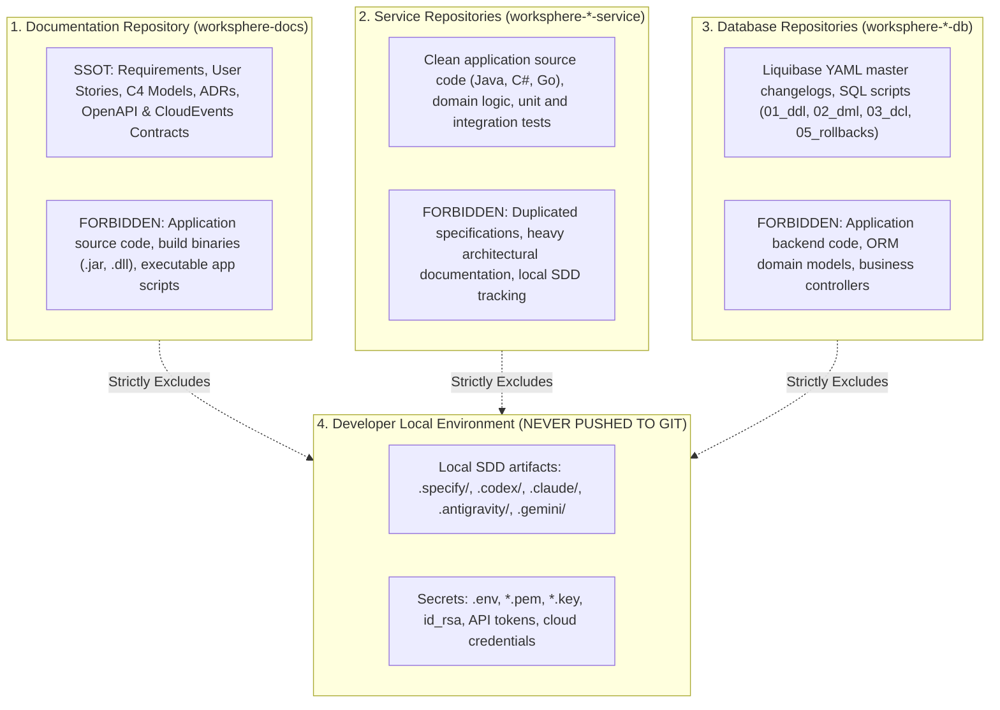

# 00 — Security Policy, Secrets Management & Repository Hygiene

> **Status:** 🟢 Stable  
> **Last Updated:** 2026-11-15  
> **Technical Lead & Architect:** Daniel (`daniel2004-lsd`)  
> **Project:** WorkSphere — Enterprise Operations Intelligence Platform  
> **Scope:** Universal across all repositories in the WorkSphere ecosystem

---

## 1. Strict Repository Boundary Separation

WorkSphere enforces an uncompromising separation of concerns across its repositories:



### Mandatory Rules:
1. **`worksphere-docs` is 100% Documentation:** It is the single source of truth (SSOT). No application logic or runtime packages may live here.
2. **`worksphere-*-service` is 100% Code:** Contains only what is needed to compile, test, and containerize the microservice. It references `worksphere-docs` for specifications; it never duplicates them.
3. **`worksphere-*-db` is 100% Database Migrations:** Contains only declarative Liquibase changelogs and SQL scripts following the canonical structure (`01_ddl`, `02_dml`, `03_dcl`, `05_rollbacks`).

---

## 2. SDD and AI Agent Workspaces are Strictly Local

Spec-Driven Development (SDD) tooling, agent harnesses, and AI assistant configurations are local developer productivity tools. **They must never be committed to remote GitHub repositories**:

### Global Blacklist (Must be present in every `.gitignore`):
```gitignore
# AI Agent Workspaces & Local Harnesses
.specify/
.codex/
.claude/
.antigravity/
.gemini/

# IDE Workspaces & Local State
.idea/
.vscode/
*.swp
*.swo
*~
.DS_Store

# Credentials, Keys & Secrets
*.env
*.env.*
!*.env.example
*.pem
*.key
*.pkcs12
*.pfx
*.jks
id_rsa
id_ed25519
*.token
credentials.json
secrets.yaml
```

---

## 3. Secrets Management & Zero-Leakage Policy

WorkSphere maintains a **Zero Credentials in Git** mandate:

1. **No Plaintext Secrets in Repositories:**  
   Database passwords, JWT signing private keys, RabbitMQ credentials, and cloud API tokens must never be hardcoded or committed to git history.
2. **Sanitized Templates Only:**  
   Only sanitized sample configuration files are permitted in version control:
   - `.env.example`
   - `liquibase.properties.example`
   All secret fields must contain explicit placeholders (e.g., `CHANGE_ME_IN_PRODUCTION`).
3. **Automated Secret Scanning:**  
   Pre-commit hooks and CI pipelines must execute `gitleaks` or GitHub Secret Scanning. Any commit attempting to push matching high-entropy patterns (private keys, AWS tokens, GitHub PATs) is automatically blocked.
4. **Environment-Driven Injection:**  
   In automated environments (CI/CD, staging, production), secrets are injected strictly via GitHub Actions Secrets, Kubernetes Secrets, or secure environment variables at runtime.

---

## 4. Documentation Language Mandate

> [!IMPORTANT]
> **Universal Language Requirement:**  
> All formal documentation in `worksphere-docs`, including architecture decision records (ADRs), user stories, requirements, API contracts, diagram descriptions, changelogs, and code comments, **must be written 100% in professional English**.
