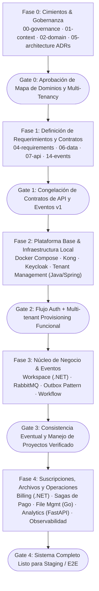

# WorkSphere — SDD Guide & Execution Plan

> **Estado:** 🟡 Inception / Planificación Inicial  
> **Arquitectura:** SaaS B2B Multi-Tenant — Microservicios Distribuidos Orientados a Eventos  
> **Estándar:** Software Design Documentation (SDD) — *Design Before Code*

---

## 🧭 ¿Qué es SDD en WorkSphere?

**Software Design Documentation (SDD)** establece que el diseño de la arquitectura distribuida, los contratos de API y los esquemas de eventos se definen y validan formalmente **antes** de tirar la primera línea de código en los microservicios.

```
Tradicional:   Código rápido -> Bugs distribuidos -> Caos de integración -> Documentación ausente
WorkSphere SDD: Diseño de Dominios -> Contratos & Eventos -> Pruebas de Aislamiento -> Implementación
```

---

## 🧱 Las Fases de Ejecución



---

## 📋 Lista de Gates y Criterios de Paso

### Gate 0: Fundamentos y Modelo Multi-Tenant
- [ ] Bounded Contexts y límites de los 8 microservicios delimitados.
- [ ] Estrategia de particionamiento lógico de datos y Row-Level Security (RLS) documentada.
- [ ] ADR-001 (Monorepo vs Multirepo), ADR-002 (Estrategia Multi-tenancy), ADR-003 (Event Broker).

### Gate 1: Especificaciones y Contratos
- [ ] Contratos OpenAPI para endpoints críticos de cada servicio.
- [ ] Catálogo de eventos CloudEvents / JSON Schema para RabbitMQ.
- [ ] Definición de esquemas de tablas con columna `tenant_id` y políticas RLS.

### Gate 2: Plataforma Base
- [ ] `docker-compose.yml` base operativo levantando PostgreSQL, RabbitMQ, Keycloak y Kong.
- [ ] Microservicio `tenant-service` registrando organizaciones y emitiendo `OrganizationCreated`.
- [ ] Keycloak configurado con multi-realm o atributos de organización por tenant.

### Gate 3: Orquestación Asíncrona
- [ ] `workspace-service` consumiendo eventos y aislando tareas por organización.
- [ ] Transactional Outbox implementado para evitar eventos fantasma o perdidos.
- [ ] Pruebas automatizadas de no-contaminación cruzada entre inquilinos (*Tenant Leakage Tests*).
