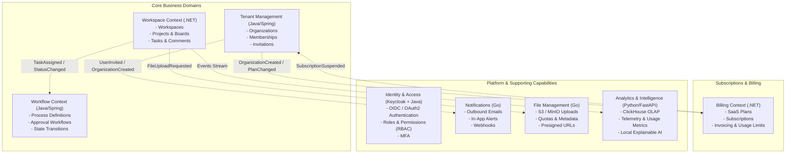

# 02 — Domain Map & Bounded Contexts (DDD)

> **Document:** Domain-Driven Design Architecture  
> **Status:** 🟢 Baseline  
> **Technical Lead & Architect:** Daniel (`daniel2004-lsd`)  
> **Project:** WorkSphere — Enterprise Operations Intelligence Platform  
> **Purpose:** Formally delineate service boundaries to eliminate coupling, data duplication, and circular inter-service dependencies.

---

## 🗺️ Bounded Contexts Map

---

## 🏛️ Responsibility & Polyglot Runtime Matrix

| Bounded Context | Core Responsibility | Runtime / Stack | Data Store |
|---|---|---|---|
| **Identity & Access** | Centralized authentication, SSO, OIDC token issuance with immutable Tenant claims and RBAC roles. | Keycloak + Java | PostgreSQL (`iam_db`) |
| **Tenant Management** | Enterprise tenant onboarding, organization lifecycle, memberships, and department structures. | Java 21 / Spring Boot 3 | PostgreSQL (`tenant_db`) |
| **Workspace** | Engineering projects, delivery milestones, tasks, boards, and approval-blocked states. | C# / ASP.NET Core (.NET 9) | PostgreSQL (`workspace_db`) |
| **Workflow** | State machines for formal approval requests, decision audit logs, and operational unblocking. | Java 21 / Spring Boot 3 | PostgreSQL (`workflow_db`) |
| **Billing** | SaaS subscription tiers, billing cycles, invoices, and quota enforcement. | C# / ASP.NET Core (.NET 9) | PostgreSQL (`billing_db`) |
| **Notifications** | Asynchronous email dispatch, mobile push notifications, and in-app alert feeds. | Go 1.22 | PostgreSQL / Redis (`notify_db`) |
| **File Management** | Secure document storage, presigned S3 URLs, virus scanning, and project attachments. | Go 1.22 | MinIO (S3) + PostgreSQL (`files_db`) |
| **Analytics & AI** | Telemetry ingestion, operational bottleneck aggregation, and permission-aware local RAG queries. | Python 3.12 / FastAPI | ClickHouse (OLAP) |

---

## 🚫 Inviolable Domain Boundary Rules

1. **Zero Cross-Database Foreign Keys:**  
   `workspace_db` must never define direct SQL foreign keys referencing tables in `tenant_db` or `workflow_db`. Logical relationships are coordinated strictly via `tenant_id`, entity IDs, and asynchronous CloudEvents.
2. **Master Data Ownership:**  
   Corporate profile and organization states belong exclusively to `Tenant Management`. Other services cache or consume tenant metadata solely via validated JWT claims or events.
3. **Temporal Decoupling:**  
   If the Notifications or Billing services are temporarily unavailable, task management and project operations **must not fail**. Events are published reliably to RabbitMQ via the Transactional Outbox pattern for guaranteed eventual delivery.
