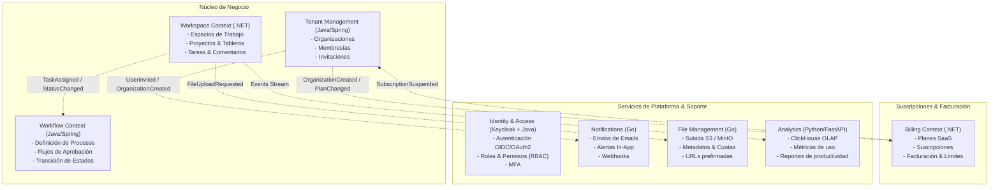

# 02 — Mapa de Dominios y Bounded Contexts (DDD)

> **Propósito:** Delimitar formalmente las fronteras de los servicios para evitar acoplamiento, duplicidad de datos y llamadas circulares.

---

## 🗺️ Mapa de Bounded Contexts

---

## 🏛️ Matriz de Responsabilidades y Runtimes

| Bounded Context | Responsabilidad Principal | Runtime / Stack | Base de Datos |
|---|---|---|---|
| **Identity & Access** | Autenticación centralizada, SSO, emisión de JWTs con claims de Tenant y RBAC. | Keycloak + Java | PostgreSQL (`iam_db`) |
| **Tenant Management** | Alta de organizaciones, configuración de inquilinos, membresías y suscripción activa. | Java 21 / Spring Boot 3 | PostgreSQL (`tenant_db`) |
| **Workspace** | Gestión de proyectos, listas de tareas, asignaciones y tableros colaborativos. | C# 12 / .NET 9 | PostgreSQL (`workspace_db`) |
| **Workflow** | Máquinas de estado de procesos de aprobación y automatizaciones de tareas. | Java 21 / Spring Boot 3 | PostgreSQL (`workflow_db`) |
| **Billing** | Gestión de planes, ciclos de cobro, facturas e integración con pasarela de pago. | C# 12 / .NET 9 | PostgreSQL (`billing_db`) |
| **Notifications** | Procesamiento asíncrono de alertas, plantillas de correo y notificaciones push. | Go 1.22 | PostgreSQL / Redis (`notify_db`) |
| **File Management** | Carga y gestión segura de documentos adjuntos asociados a tareas y proyectos. | Go 1.22 | MinIO (S3) + PostgreSQL (`files_db`) |
| **Analytics** | Agregación de métricas de uso, telemetría de tareas y reportes de productividad. | Python 3.12 / FastAPI | ClickHouse (OLAP) |

---

## 🚫 Reglas de Frontera Inviolables

1. **Sin queries inter-base de datos:** `workspace_db` jamás tendrá claves foráneas directas (`FOREIGN KEY`) apuntando a tablas de `tenant_db`. La relación se realiza lógicamente mediante `tenant_id` y `organization_id` transferidos en el token y eventos.
2. **Los datos maestros residen en su dueño:** La información del perfil empresarial vive exclusivamente en `Tenant Management`. Otros servicios únicamente cachean u operan con el `tenant_id` y el identificador de usuario.
3. **Desacoplamiento temporal:** Si el servicio de Billing o Notifications está temporalmente fuera de servicio, la creación de una organización o tarea **no debe fallar**; se emite el evento al Broker para que se procese tan pronto el servicio se recupere.
