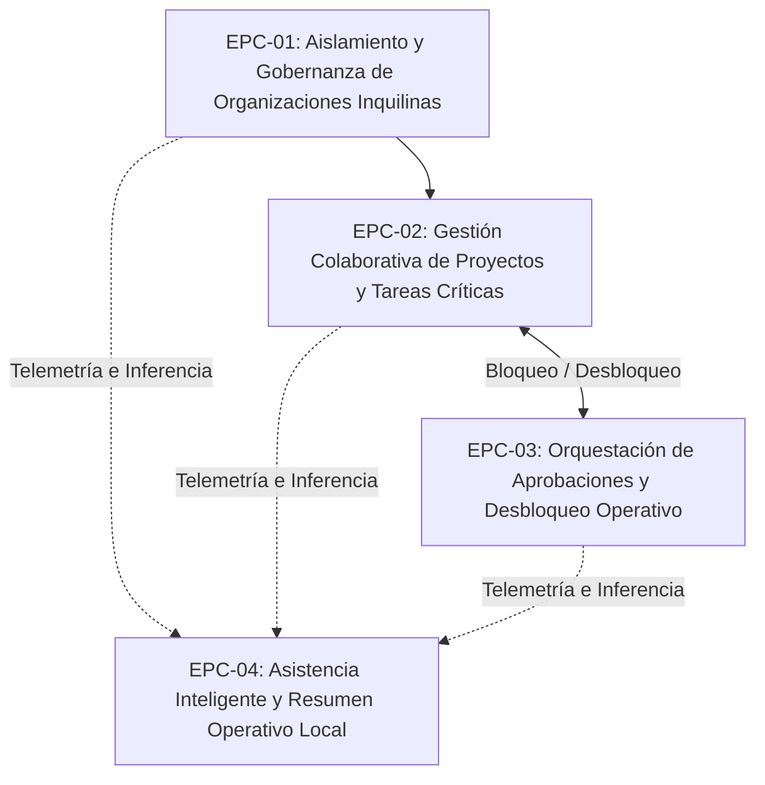

# 03 — Product Backlog y Desglose de Épicas de Producto

> **Estado:** 🟢 Estable (Fase 0 — Definición)  
> **Líder Técnico & Arquitecto:** Daniel (`daniel2004-lsd`)  
> **Proyecto:** WorkSphere — Enterprise Operations Intelligence Platform  
> **Alcance:** Tríada Esencial del MVP (Organization, Workspace, Workflow)

---

## 1. Inventario de Épicas de Producto (Capa de Planeación)

Las Épicas de Producto describen los objetivos estratégicos de negocio. Siguen el formato canónico `EPC-NN: Título descriptivo`.

| ID Épica | Nombre de la Épica de Producto | Bounded Contexts Asociados | Objetivo Empresarial |
|:---:|---|---|---|
| **EPC-01** | Aislamiento y Gobernanza de Organizaciones Inquilinas | Identity & Access, Tenant Management | Permitir que múltiples empresas operen de forma independiente con estricta segregación de datos (RLS) y administración jerárquica de miembros. |
| **EPC-02** | Gestión Colaborativa de Proyectos y Tareas Críticas | Workspace Context (.NET) | Proporcionar visibilidad estructurada de los proyectos de ingeniería, hitos, tareas y dependencias de entrega del equipo. |
| **EPC-03** | Orquestación de Aprobaciones y Desbloqueo Operativo | Workflow Context (Spring Boot) | Formalizar y auditar las decisiones empresariales que detienen el avance operativo, eliminando los cuellos de botella informales. |
| **EPC-04** | Asistencia Inteligente y Resumen Operativo Local | Analytics & AI Intelligence Layer | Ofrecer resúmenes explicables y detección de bloqueos en proyectos mediante modelos locales (Ollama/RAG) basados en hechos autorizados. |

---

## 2. Desglose de Features (`FEA-NNN`) por Épica de Producto

### EPC-01: Aislamiento y Gobernanza de Organizaciones Inquilinas
- **`FEA-001: Aprovisionamiento de Organización e Inquilino (Tenant)`**  
  Registro formal de empresa, asignación de `tenant_id` determinista, validación de slug y publicación transaccional de alta.
- **`FEA-002: Estructura Jerárquica y Membresías`**  
  Creación de departamentos, invitación de colaboradores por correo y asignación de roles corporativos (Admin, Gestor, Miembro).
- **`FEA-003: Control de Acceso y Contexto Criptográfico OIDC`**  
  Autenticación centralizada con Keycloak y emisión de JWTs enriquecidos con el claim `tenant_id` y permisos RBAC.

### EPC-02: Gestión Colaborativa de Proyectos y Tareas Críticas
- **`FEA-004: Espacios de Trabajo y Proyectos de Ingeniería`**  
  Creación de proyectos vinculados a departamentos o clientes, definición de fechas meta, responsables y estados.
- **`FEA-005: Ciclo de Vida de Tareas y Dependencias`**  
  Gestión de tareas, prioridades, subtareas y transiciones de estado (`TODO`, `IN_PROGRESS`, `BLOCKED`, `DONE`).
- **`FEA-006: Estado Bloqueado por Aprobación Operativa`**  
  Capacidad de asociar una tarea a un requisito de aprobación formal, suspendiendo su ejecución hasta la resolución del flujo.

### EPC-03: Orquestación de Aprobaciones y Desbloqueo Operativo
- **`FEA-007: Definición y Tipificación de Procesos de Aprobación`**  
  Plantillas para tipos comunes de solicitud: Aprobación de Presupuesto, Cambio de Alcance, Asignación de Recursos, Autorización Técnica.
- **`FEA-008: Solicitud Formal y Enrutamiento Jerárquico`**  
  Creación de la solicitud desde la tarea, asignación automática al aprobador correspondiente según rol/departamento.
- **`FEA-009: Decisión Auditable e Historial Inmutable`**  
  Registro inmutable de la aprobación/rechazo: actor, rol, timestamp, justificación y emisión de evento asíncrono para desbloqueo de la tarea.

### EPC-04: Asistencia Inteligente y Resumen Operativo Local
- **`FEA-010: Resumen Ejecutivo de Bloqueos en Proyectos`**  
  Generación de informes de síntesis que correlacionan tareas detenidas con las solicitudes de aprobación pendientes.
- **`FEA-011: Consultas de Estado en Lenguaje Natural Autenticadas`**  
  Asistente local que responde preguntas sobre proyectos y capacidad respetando estrictamente los permisos del usuario.

---

## 3. Matriz del Product Backlog (Historias de Planeación `HU-NN`)

| ID Plan | Épica | Feature | Historia de Usuario (Título en Infinitivo) | Prioridad | Mapeo a Ejecución |
|:---:|:---:|:---:|---|:---:|:---:|
| **HU-01** | EPC-01 | FEA-001 | Registrar organización con validación de slug y outbox | P1 | `HU-TENANT-001` |
| **HU-02** | EPC-01 | FEA-002 | Invitar colaborador y asignar membresía de departamento | P1 | `HU-TENANT-002` |
| **HU-03** | EPC-01 | FEA-003 | Autenticar usuario y emitir token OIDC con claim tenant_id | P1 | `HU-IAM-001` |
| **HU-04** | EPC-02 | FEA-004 | Crear proyecto operativo delimitado por tenant | P1 | `HU-WORKSPACE-001` |
| **HU-05** | EPC-02 | FEA-005 | Crear tarea con asignación y fecha límite | P1 | `HU-WORKSPACE-002` |
| **HU-06** | EPC-02 | FEA-006 | Bloquear tarea al requerir aprobación operativa | P0 | `HU-WORKSPACE-003` |
| **HU-07** | EPC-03 | FEA-007 | Configurar proceso de aprobación con reglas de negocio | P1 | `HU-WORKFLOW-001` |
| **HU-08** | EPC-03 | FEA-008 | Emitir solicitud de aprobación vinculada a tarea crítica | P0 | `HU-WORKFLOW-002` |
| **HU-09** | EPC-03 | FEA-009 | Resolver aprobación y emitir evento de desbloqueo | P0 | `HU-WORKFLOW-003` |
| **HU-10** | EPC-02 | FEA-006 | Desbloquear automáticamente tarea tras aprobación confirmada | P0 | `HU-WORKSPACE-004` |
| **HU-11** | EPC-04 | FEA-010 | Generar resumen de bloqueos de proyecto con IA local | P2 | `HU-ANALYTICS-001` |
| **HU-12** | EPC-04 | FEA-011 | Consultar estado de tareas mediante asistente RLS local | P2 | `HU-ANALYTICS-002` |
