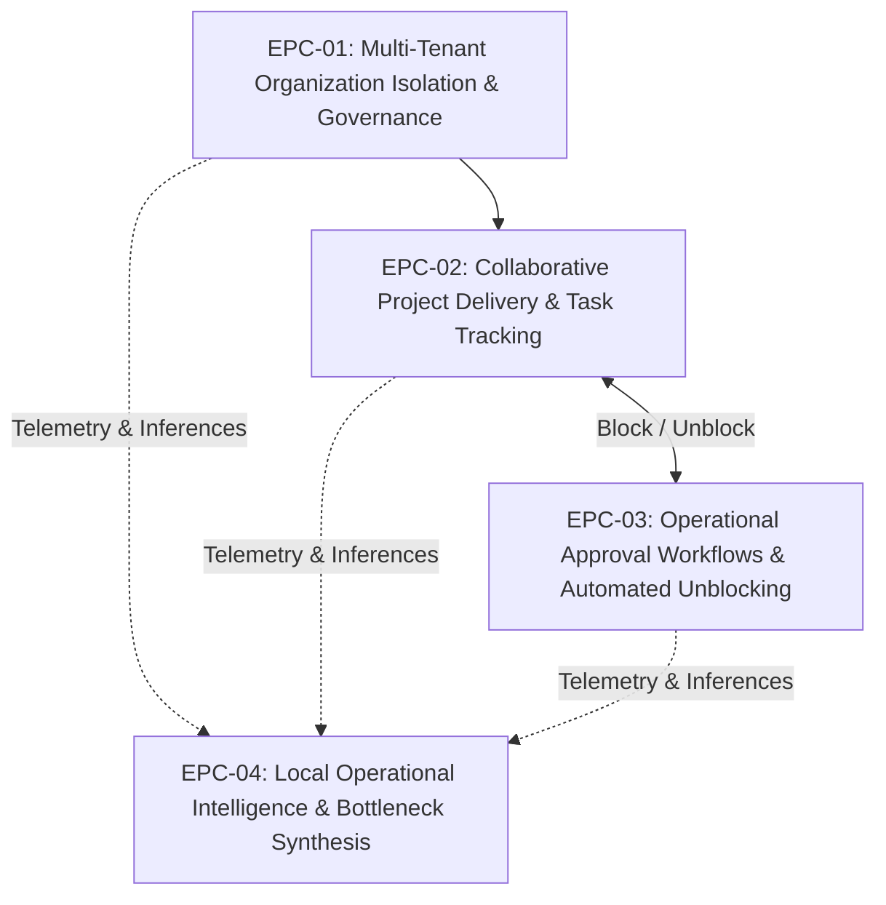

# 03 — Product Backlog & Product Epics Breakdown

> **Status:** 🟢 Baseline (Phase 0 — Business Definition)  
> **Technical Lead & Architect:** Daniel (`daniel2004-lsd`)  
> **Project:** WorkSphere — Enterprise Operations Intelligence Platform  
> **Scope:** MVP Essential Triad (Organization, Workspace, Workflow)

---

## 1. Product Epics Inventory (Planning Layer)

Product Epics describe high-level strategic business outcomes. They follow the canonical identifier format `EPC-NN: Descriptive Title`.

| Epic ID | Product Epic Title | Target Bounded Contexts | Business Objective |
|:---:|---|---|---|
| **EPC-01** | Multi-Tenant Organization Isolation & Governance | Identity & Access, Tenant Management | Enable enterprise organizations to operate independently with strict data segregation (RLS) and department management. |
| **EPC-02** | Collaborative Project Delivery & Task Tracking | Workspace Context (.NET) | Provide structured visibility into engineering projects, delivery milestones, tasks, and team deliverables. |
| **EPC-03** | Operational Approval Workflows & Automated Unblocking | Workflow Context (Spring Boot) | Formalize and audit business decisions that block delivery milestones, eliminating informal communication bottlenecks. |
| **EPC-04** | Local Operational Intelligence & Bottleneck Synthesis | Analytics & AI Layer | Deliver verifiable summaries and bottleneck detection using local models (Ollama/RAG) strictly based on authorized data. |

---

## 2. Features Breakdown (`FEA-NNN`)

### EPC-01: Multi-Tenant Organization Isolation & Governance
- **`FEA-001: Tenant Organization Provisioning`**  
  Corporate company registration, deterministic `tenant_id` generation, slug collision prevention, and transactional outbox event publishing.
- **`FEA-002: Hierarchical Departments and Memberships`**  
  Department setup, email invitations, and corporate role assignment (Admin, Manager, Member).
- **`FEA-003: Cryptographic Access Control & OIDC Context`**  
  Keycloak central authentication emitting JWTs with immutable `tenant_id` and RBAC claims.

### EPC-02: Collaborative Project Delivery & Task Tracking
- **`FEA-004: Engineering Workspaces and Projects`**  
  Project creation, lead assignments, target dates, and status tracking.
- **`FEA-005: Task Lifecycle Management`**  
  Task creation, priority levels, assignment, and status transitions (`TODO`, `IN_PROGRESS`, `BLOCKED`, `DONE`).
- **`FEA-006: Blocked by Operational Approval State`**  
  Binding tasks to formal approval requirements, suspending progress until resolution.

### EPC-03: Operational Approval Workflows & Automated Unblocking
- **`FEA-007: Approval Process Definitions`**  
  Standardized request templates: Budget Authorization, Scope Change, Resource Allocation, Technical Sign-off.
- **`FEA-008: Request Submission and Approver Routing`**  
  Initiating requests from tasks, routing to designated authority based on role and department.
- **`FEA-009: Auditable Decision & Immutable History`**  
  Immutable approval/rejection logging with actor ID, timestamp, and mandatory comment, triggering asynchronous unblocking events.

### EPC-04: Local Operational Intelligence & Bottleneck Synthesis
- **`FEA-010: Executive Bottleneck Synthesis`**  
  Automated summary reports correlating delayed tasks with pending approval requests.
- **`FEA-011: Permission-Aware Natural Language Queries`**  
  Local assistant answering status questions while adhering to user Row-Level Security permissions.

---

## 3. Product Backlog Matrix (Planning Stories `HU-NN`)

| Plan ID | Epic | Feature | User Story Title (Infinitive Form) | Priority | Execution Mapping |
|:---:|:---:|:---:|---|:---:|:---:|
| **HU-01** | EPC-01 | FEA-001 | Register organization with slug validation and outbox | P1 | `HU-TENANT-001` |
| **HU-02** | EPC-01 | FEA-002 | Invite team member and assign department role | P1 | `HU-TENANT-002` |
| **HU-03** | EPC-01 | FEA-003 | Authenticate user and issue OIDC token with tenant_id | P1 | `HU-IAM-001` |
| **HU-04** | EPC-02 | FEA-004 | Create operational project isolated by tenant | P1 | `HU-WORKSPACE-001` |
| **HU-05** | EPC-02 | FEA-005 | Create task with priority and deadline | P1 | `HU-WORKSPACE-002` |
| **HU-06** | EPC-02 | FEA-006 | Block task when requiring operational approval | P0 | `HU-WORKSPACE-003` |
| **HU-07** | EPC-03 | FEA-007 | Configure approval process template with business rules | P1 | `HU-WORKFLOW-001` |
| **HU-08** | EPC-03 | FEA-008 | Submit formal approval request linked to critical task | P0 | `HU-WORKFLOW-002` |
| **HU-09** | EPC-03 | FEA-009 | Resolve approval request and publish unblocking event | P0 | `HU-WORKFLOW-003` |
| **HU-10** | EPC-02 | FEA-006 | Automatically unblock task upon approval event receipt | P0 | `HU-WORKSPACE-004` |
| **HU-11** | EPC-04 | FEA-010 | Generate project bottleneck summary using local AI | P2 | `HU-ANALYTICS-001` |
| **HU-12** | EPC-04 | FEA-011 | Query operational status via RLS-compliant assistant | P2 | `HU-ANALYTICS-002` |
