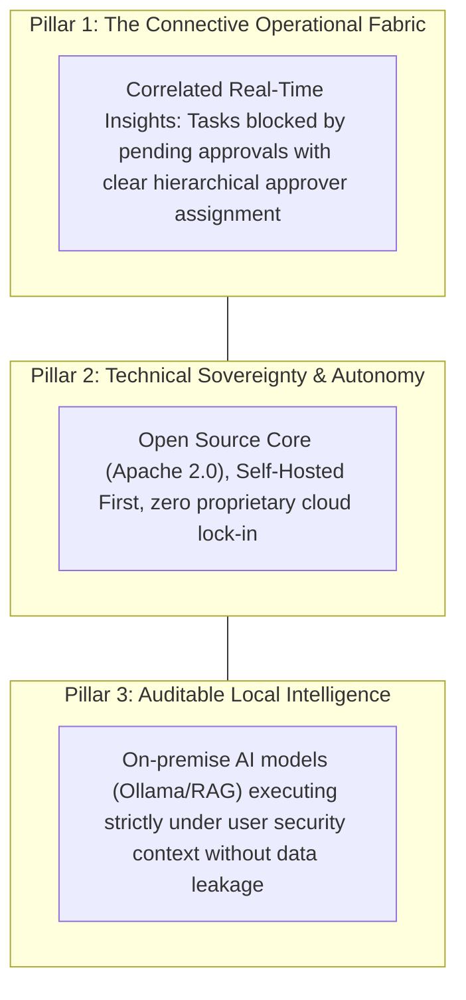

# 03 — Product Vision & Strategic Differentiation

> **Document:** Product Vision & Core Value Proposition  
> **Status:** Phase 0 — Business Definition  
> **Technical Lead & Architect:** Daniel (`daniel2004-lsd`)  
> **Project:** WorkSphere — Enterprise Operations Intelligence Platform

---

## 1. Product Vision Statement

> **For** technology consultancies, software factories, and professional services firms  
> **Who** suffer from project delivery delays due to stalled approvals, team overload, and fragmented operational data  
> **WorkSphere** is an enterprise-grade B2B Operations Intelligence SaaS platform  
> **That** connects organizational structure, project deliverables, and approval workflows into a unified, auditable graph  
> **Unlike** traditional task management tools (Jira, Asana, Monday) and closed proprietary SaaS platforms  
> **Our product** delivers complete sovereignty (*Self-Hosted & Open Source First*), strict database-level data governance via PostgreSQL Row-Level Security, audit-proof Liquibase versioning, and private, explainable local AI assistance.

---

## 2. The Three Pillars of Differentiation

---

## 3. The MVP Essential Triad (Phase 1 Scope)

The Minimum Viable Product (MVP) demonstrates deep vertical integration across three foundational capabilities:

### 3.1. Organization & Access
- Multi-tenant company onboarding with tenant isolation.
- Departments, teams, and hierarchical memberships.
- Authority matrix: defining who holds the authority to approve specific operational requests.

### 3.2. Projects & Tasks
- Engineering projects and critical delivery milestones.
- Explicit task lifecycle states (including `BLOCKED_BY_APPROVAL`).
- Progress and health metrics tied to operational blockers.

### 3.3. Approval Workflows
- Structured approval request definitions (e.g., Budget Authorization, Scope Change, Technical Sign-off).
- Direct binding: an approval request dynamically suspends or unblocks related project tasks.
- Immutable decision audit trail: approver ID, role at decision time, timestamp, mandatory justification comment, and cycle time metrics.
