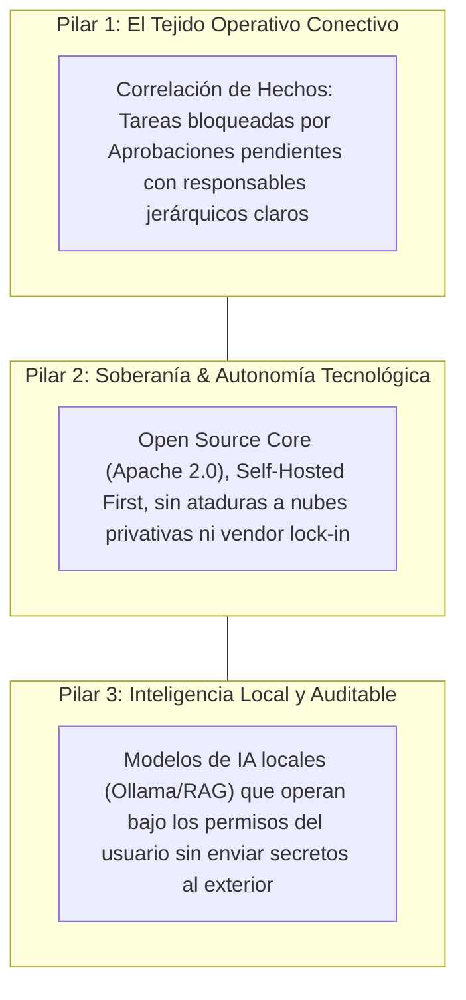

# 03 — Visión del Producto y Propuesta de Valor (Product Vision)

> **Documento:** Product Vision & Strategy  
> **Estado:** Fase 0 — Definición de Negocio  
> **Líder Técnico & Arquitecto:** Daniel (`daniel2004-lsd`)  
> **Proyecto:** WorkSphere — Enterprise Operations Intelligence Platform

---

## 1. Declaración de Visión

> **Para** consultoras tecnológicas, fábricas de software y empresas de servicios profesionales  
> **Que** enfrentan retrasos en sus entregas por cuellos de botella en aprobaciones, sobrecarga de equipos y fragmentación de datos  
> **WorkSphere** es una plataforma SaaS B2B empresarial de inteligencia de operaciones  
> **Que** conecta la estructura organizacional, los proyectos y los flujos de aprobación en un grafo operativo unificado con trazabilidad inmutable  
> **A diferencia de** los gestores de tareas tradicionales (Jira, Asana, Monday) y plataformas SaaS propietarias cerradas  
> **Nuestro producto** ofrece soberanía absoluta (*Self-Hosted & Open Source First*), gobernanza de datos estricta con Row-Level Security, versionamiento auditable con Liquibase e inteligencia artificial local explicable y libre de fugas de datos.

---

## 2. Los Tres Pilares de Diferenciación



---

## 3. La Tríada Esencial del MVP (Fase 1)

El producto mínimo viable de WorkSphere no implementará diez dominios superficiales. Demostrará la **integración vertical profunda** de tres capacidades indispensables:

### 3.1. Organization & Access
- Gestión de organizaciones inquilinas (*Multi-Tenancy*).
- Departamentos, roles y asignaciones jerárquicas.
- Matriz de autoridad: quién puede aprobar qué tipo de solicitud dentro de la empresa.

### 3.2. Projects & Tasks
- Proyectos con hitos y tareas críticas.
- Estados explícitos de ciclo de vida (incluyendo `BLOCKED_BY_APPROVAL`).
- Métricas de avance e impacto operativo.

### 3.3. Approval Workflows
- Procesos de aprobación estructurados (ej. Aprobación de Cambios, Asignación de Recursos, Validación Técnica).
- Vinculación directa: una solicitud puede bloquear o habilitar una tarea en un proyecto.
- Historial de decisiones inmutable: actor, rol, timestamp, justificación y tiempo de ciclo.

---

## 4. Evolución de Capacidades (Roadmap Conceptual)

```
[MVP: Tríada Esencial]
  - Multi-tenant Organization Management
  - Projects & Tasks con bloqueo por aprobación
  - Approval Workflows formales e inmutables
  - IA Resumen Operativo Local (hechos verificables)
           │
           ▼
[Fase 2: Conectividad Externa & Automatización]
  - Webhooks de entrada para GitHub / GitLab / Jira
  - RabbitMQ Event-Driven Outbox & Sagas
  - Notificaciones multicanal (Email, In-App)
           │
           ▼
[Fase 3: Inteligencia Avanzada & Monetización SaaS]
  - Analítica de cuellos de botella con ClickHouse
  - Planes y control de cuotas (Billing Service)
  - Agentes de IA asistida para balanceo de carga
```
