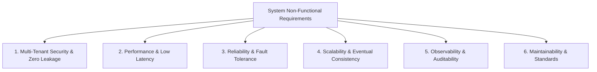

# 04 — Non-Functional Requirements & System Quality Attributes

> **Document:** System Quality Attributes, SLAs & Architectural Constraints  
> **Status:** 🟢 Baseline  
> **Technical Lead & Architect:** Daniel (`daniel2004-lsd`)  
> **Project:** WorkSphere — Enterprise Operations Intelligence Platform

---

## 1. Quality Attribute Overview

WorkSphere establishes measurable engineering thresholds across six core dimensions to guarantee enterprise-grade operational stability.

---

## 2. Measurable Requirements Matrix

| ID | Category | Metric / Requirement | Target SLA / Threshold | Verification Method |
|:---:|---|---|---|---|
| **NFR-SEC-01** | Security | Cross-Tenant Data Isolation | **0% leakage** under any query or payload mutation. | Automated integration tests executing cross-tenant reads/writes against PostgreSQL RLS. |
| **NFR-SEC-02** | Security | Authentication & Context Propagation | All requests must contain verified cryptographic OIDC JWT with `tenant_id`. | Gateway automated rejection (`401 Unauthorized` / `403 Forbidden`). |
| **NFR-PERF-01** | Performance | API Synchronous Response Time | **p95 < 200ms**, **p99 < 500ms** for standard CRUD endpoints under nominal load (1,000 req/min). | Load test execution via k6 / Locust in staging environment. |
| **NFR-PERF-02** | Performance | Database Query Execution Time | **p95 < 50ms** for relational transactional queries indexed by `tenant_id`. | PostgreSQL `pg_stat_statements` slow query logging threshold set at 50ms. |
| **NFR-REL-01** | Reliability | Platform Service Availability | **99.9% Uptime** (excluding scheduled maintenance). | Continuous synthetic monitoring via Prometheus blackbox exporter. |
| **NFR-REL-02** | Reliability | Asynchronous Outbox Delivery | **Zero event loss** on service crashes or temporary RabbitMQ broker downtime. | Chaos testing simulating network partition during active transaction commit. |
| **NFR-REL-03** | Reliability | Event Propagation Latency | Event publication and consumption cycle completed in **< 1,000ms** (p95). | Distributed trace duration between Outbox insert and consumer ACK. |
| **NFR-SCA-01** | Scalability | Multi-Tenant Data Density | Support up to **5,000 active organizations** per database cluster using shared schema + RLS without table explosion. | Benchmarking partitioned indices and connection pool sizing. |
| **NFR-OBS-01** | Observability | End-to-End Trace Context | **100% of inter-service calls** must propagate W3C `traceparent` headers. | OpenTelemetry collector trace sampling and Tempo validation. |
| **NFR-MNT-01** | Maintainability | Schema Reversibility | **100% of DDL changes** must include an automated, tested `<rollback>` script. | Liquibase `updateTestingRollback` execution in CI/CD pipeline. |
