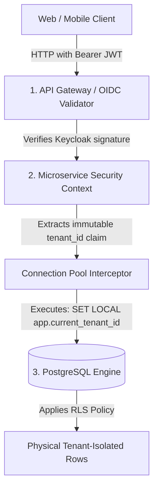

# ADR-002: Multi-Tenant Data Isolation Strategy with Keycloak OIDC and PostgreSQL RLS

- **Status:** Accepted
- **Date:** 2026-11-15
- **Decision Makers:** Daniel (`daniel2004-lsd`) — Software Architect & Technical Lead
- **Scope:** All relational microservices and databases in WorkSphere

---

## 1. Context and Problem Statement

WorkSphere is a multi-tenant platform where multiple companies share the same compute instances and database instances (*Shared Database, Shared Schema* per microservice).

Data belonging to Company A (`tenant-A`) must never be accessible or mutable by users of Company B (`tenant-B`).

Risks mitigated:
1. **Accidental Developer Omission:** A query in an ORM omitting `WHERE tenant_id = :tenant_id` must not leak cross-tenant records.
2. **SQL Injection Vulnerabilities:** Application-level flaws must be stopped by the database engine itself.
3. **Identity Spoofing:** Users must not be able to forge or inject arbitrary tenant IDs in HTTP payloads.

---

## 2. Evaluated Alternatives

| Option | Description | Trade-offs |
|---|---|---|
| **Option A: Separate Database per Tenant** | Creating a physical database or isolated schema per customer company. | High isolation, but unsustainable infrastructure cost, connection pool exhaustion, and complex Liquibase migration orchestration across thousands of tenants. |
| **Option B: Application-Level Filtering Only** | Relying strictly on ORM interceptors and `WHERE tenant_id = ?` clauses. | High risk of critical data leaks (*Tenant Leakage*) if a single query omits the predicate. |
| **Option C: Hybrid OIDC Token Context + PostgreSQL Row-Level Security (RLS)** | JWT tokens issued by Keycloak contain immutable `tenant_id` claims, combined with native PostgreSQL RLS engine policies. | **Selected:** Defense-in-depth. Even if application code errs, PostgreSQL physically blocks reading or writing rows belonging to other tenants. |

---

## 3. Decision

We implement a **3-Layer Defense-in-Depth Model**:



### 1. Immutable Identity Context (Keycloak OIDC)
- Tokens issued contain:
  ```json
  {
    "sub": "usr_99812",
    "email": "carlos@techsolutions.com",
    "tenant_id": "ten_techsolutions_15d1e947",
    "roles": ["workspace_admin", "project_manager"]
  }
  ```
- Microservices extract the tenant identity strictly from the verified cryptographic JWT signature.

### 2. Session Context Injection
- The application connection pool executes `SET LOCAL app.current_tenant_id = '<tenant_id>'` before every transaction.

### 3. PostgreSQL Engine Defense (RLS)
- Every tenant-owned table enables RLS in its Liquibase changelog:
  ```sql
  ALTER TABLE <table_name> ENABLE ROW LEVEL SECURITY;
  
  CREATE POLICY tenant_isolation_policy ON <table_name>
      FOR ALL TO PUBLIC
      USING (
          tenant_id = current_setting('app.current_tenant_id', true)
          OR current_setting('app.current_tenant_id', true) = 'SYSTEM'
      );
  ```

---

## 4. Consequences

### Positive:
- Verifiable, audit-proof database security.
- High resource efficiency and scalability for thousands of tenants.
- System workers (Outbox relay, RabbitMQ consumers) authenticate explicitly as `SYSTEM` to process cross-tenant events in background tasks safely.
