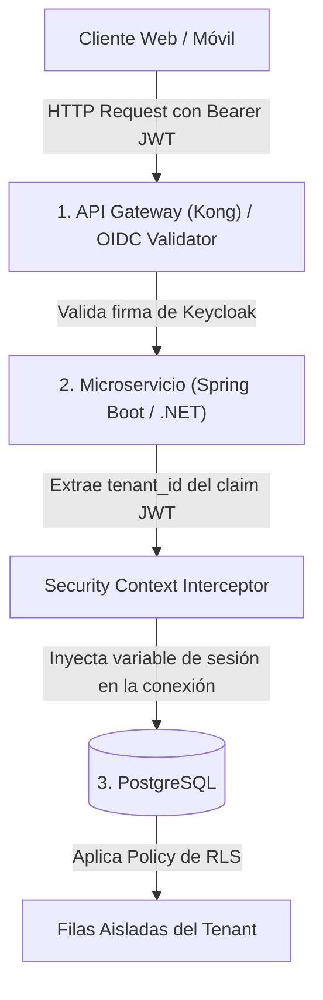

# ADR-002: Estrategia de Aislamiento Multi-Tenant con Keycloak OIDC y PostgreSQL RLS

- **Estado:** Aceptado
- **Fecha:** 2026-11-15
- **Decisores:** Daniel (Arquitecto de Software & Tech Lead)
- **Ámbito:** Todos los microservicios y bases de datos relacionales de WorkSphere

---

## 1. Contexto y Problema

WorkSphere es una plataforma SaaS B2B empresarial donde múltiples organizaciones comparten la misma infraestructura de cómputo y clústeres de base de datos (*Shared Database, Shared Schema* por microservicio).

Bajo ninguna circunstancia los datos de una empresa (`tenant-A`) pueden ser visibles ni modificados por usuarios de otra empresa (`tenant-B`).

Los riesgos que debemos mitigar son:
1. **Filtros olvidados en consultas de aplicación:** Si un desarrollador o agente de IA omite accidentalmente la cláusula `WHERE tenant_id = :current_tenant_id` en una consulta JPA o Entity Framework, la base de datos podría filtrar registros ajenos.
2. **Inyección SQL o evasión de ORM:** Una vulnerabilidad a nivel de código no debe comprometer los datos de otros clientes.
3. **Falsificación de identidad o contexto de tenant:** Un usuario no puede inyectar un `tenant_id` arbitrario en los headers o body de las peticiones HTTP.

---

## 2. Alternativas Evaluadas

| Opción | Descripción | Ventajas | Desventajas |
|---|---|---|---|
| **Opción A: Base de datos separada por tenant** | Una base de datos física o esquema completo por cada empresa cliente. | Aislamiento físico absoluto. | Costo exorbitante en infraestructura, dificultad de orquestación de miles de migraciones con Liquibase y problemas de conexión en local. |
| **Opción B: Aislamiento exclusivo a nivel de aplicación** | Filtrado únicamente mediante cláusulas `WHERE tenant_id = ?` en el código del microservicio. | Sencillo de implementar inicialmente. | **Altísimo riesgo de fuga de datos (*Tenant Leakage*)**: un solo bug en un query expone datos de toda la plataforma. |
| **Opción C: Híbrido — Contexto Criptográfico OIDC + PostgreSQL Row-Level Security (RLS)** | Token JWT firmado por Keycloak que contiene el claim inmutable `tenant_id`, complementado con políticas RLS obligatorias en todas las tablas de PostgreSQL. | **Defensa en profundidad**: aunque el código falle, el motor de PostgreSQL bloquea físicamente la lectura/escritura de filas ajenas. | Requiere configurar la sesión de conexión con `SET LOCAL app.current_tenant_id` en el pool antes de cada transacción. |

---

## 3. Decisión

Se adopta la **Opción C: Enfoque de Defensa en Profundidad en 3 Capas**:



### Capa 1: Identidad y Contexto Inmutable (Keycloak)
- El usuario se autentica contra Keycloak.
- Keycloak emite un token JWT que incluye de forma estricta los claims de tenant y organización:
  ```json
  {
    "sub": "usr_99812",
    "email": "carlos@techsolutions.com",
    "tenant_id": "ten_techsolutions_15d1e947",
    "organization_slug": "techsolutions",
    "roles": ["workspace_admin", "project_manager"]
  }
  ```
- El Gateway y los microservicios **nunca aceptan el `tenant_id` desde el body o query params** para determinar el inquilino; se extrae únicamente del payload criptográfico firmado del JWT.

### Capa 2: Filtro de Dominio a Nivel de Aplicación
- Los repositorios y servicios inyectan automáticamente el `tenant_id` en todas las operaciones de inserción y consulta como primer nivel de control.

### Capa 3: PostgreSQL Row-Level Security (RLS) como Barrera Física
- Toda tabla de negocio que pertenezca a un inquilino **debe activar RLS** en su changelog de Liquibase:
  ```sql
  ALTER TABLE <nombre_tabla> ENABLE ROW LEVEL SECURITY;
  
  CREATE POLICY tenant_isolation_policy ON <nombre_tabla>
      FOR ALL
      TO PUBLIC
      USING (
          tenant_id = current_setting('app.current_tenant_id', true)
          OR current_setting('app.current_tenant_id', true) = 'SYSTEM'
      );
  ```
- Antes de ejecutar cualquier query en la conexión del pool:
  ```sql
  SET LOCAL app.current_tenant_id = 'ten_techsolutions_15d1e947';
  ```
- Si un query malicioso o defectuoso intenta hacer `SELECT * FROM tasks`, PostgreSQL solo retornará las filas cuyo `tenant_id` coincida con la variable de sesión actual.

---

## 4. Consecuencias

### Positivas:
- **Seguridad comprobable y auditable:** La base de datos es la última línea de defensa infalible.
- **Escalabilidad y eficiencia de recursos:** Permite miles de inquilinos en una misma base de datos sin sobrecostes de infraestructura.
- **Trazabilidad:** Facilita la auditoría de accesos por tenant.

### Desafíos & Mitigaciones:
- **Sobrecarga de conexión:** Ejecutar `SET LOCAL` en cada transacción del pool de conexiones. Se mitiga mediante interceptores nativos de HikariCP / EF Core DbConnectionInterceptor.
- **Procesos en segundo plano (Workers / Schedulers):** Los workers del Outbox y consumidores de RabbitMQ que operan en nombre del sistema deben identificarse explícitamente como `SYSTEM` (`SET LOCAL app.current_tenant_id = 'SYSTEM'`) para procesar eventos de cualquier tenant de forma autorizada.
