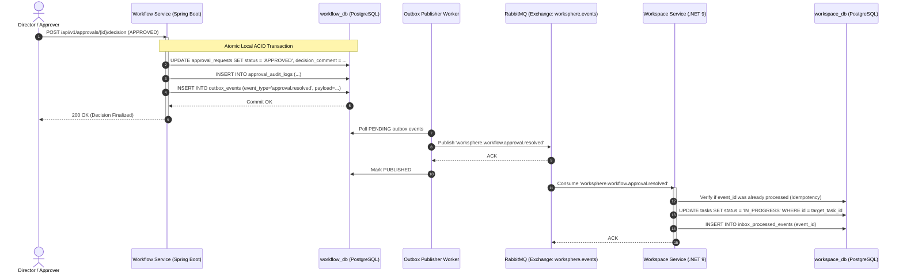

# ADR-003: Asynchronous Operational Unblocking via RabbitMQ and Choreography Saga

- **Status:** Accepted
- **Date:** 2026-11-15
- **Decision Makers:** Daniel (`daniel2004-lsd`) — Software Architect & Technical Lead
- **Scope:** `workspace-service`, `workflow-service`, RabbitMQ Messaging

---

## 1. Context and Problem Statement

The core differentiator of WorkSphere's MVP is real-time operational correlation between delivery tasks and business approvals:
1. An engineering task in `workspace-service` requires a formal sign-off (e.g., budget approval) and transitions to `BLOCKED_BY_APPROVAL`.
2. A formal approval request is managed and audited in `workflow-service`.
3. Once decided (`APPROVED` or `REJECTED`), the affected task in `workspace-service` must reliably unblock and resume execution.

Problem to solve: **How to coordinate state transitions across microservices without synchronous HTTP coupling or distributed 2PC/XA transactions?**

---

## 2. Decision

We adopt an **Asynchronous Event-Driven Choreography Saga backed by the Transactional Outbox Pattern**:

### Mandatory Implementation Standards:
1. **Consumer Idempotency:** The consuming service tracks `event_id` in an `inbox_processed_events` table to handle duplicate deliveries gracefully.
2. **Tenant Boundary Validation:** The consumer ensures the event's `tenant_id` matches the task's tenant before mutating state.
3. **Dead Letter Queue (DLQ):** Messages failing 3 retry attempts are routed to `worksphere.events.dlq` for human inspection.
