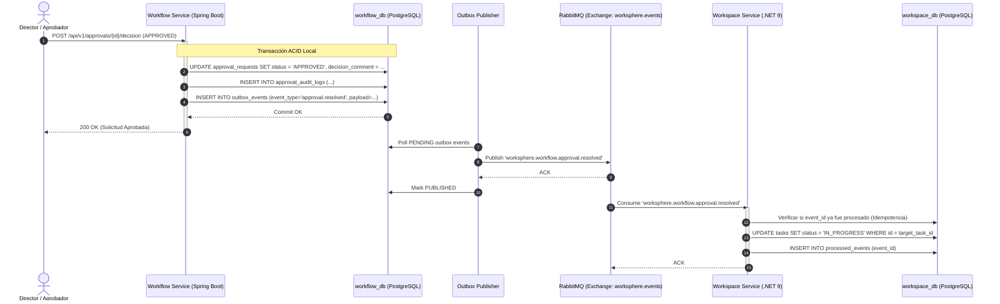

# ADR-003: Coordinación de Desbloqueo Operativo Asíncrono mediante RabbitMQ y Choreography Saga

- **Estado:** Aceptado
- **Fecha:** 2026-11-15
- **Decisores:** Daniel (Arquitecto de Software & Tech Lead)
- **Ámbito:** `workspace-service`, `workflow-service`, RabbitMQ

---

## 1. Contexto y Problema

Uno de los pilares del MVP de WorkSphere es la correlación real entre Proyectos y Aprobaciones:
1. Una tarea en `workspace-service` requiere una aprobación formal y cambia su estado a `BLOCKED_BY_APPROVAL`.
2. Una solicitud de aprobación se procesa y audita en `workflow-service`.
3. Al resolverse (`APPROVED` o `REJECTED`), la tarea vinculada en `workspace-service` debe enterarse de forma garantizada para actualizar su estado (`IN_PROGRESS` o rechazada).

El problema técnico a resolver es: **¿Cómo coordinar el cambio de estado entre dos microservicios con bases de datos distintas sin acoplamiento temporal ni transacciones distribuidas XA?**

---

## 2. Alternativas Evaluadas

| Enfoque | Descripción | Ventajas | Desventajas |
|---|---|---|---|
| **Opción A: Llamada HTTP Síncrona Directa (REST)** | `Workflow Service` llama por HTTP a `Workspace Service` al momento de aprobar. | Fácil de escribir en código inicial. | **Acoplamiento temporal**: Si `Workspace Service` está reiniciando o hay latencia de red, la aprobación falla o se pierde la sincronización. Violación de independencia de microservicios. |
| **Opción B: Base de datos compartida** | Ambos servicios escriben en las mismas tablas. | Consistencia inmediata ACID. | **Violación total del principio Database-per-Service**: genera dependencias circulares, bloqueos de concurrencia y destruye la arquitectura. |
| **Opción C: Coreografía Asíncrona basada en Eventos con Transactional Outbox** | Al aprobarse, `Workflow Service` guarda la decisión y un evento `approval.resolved` en su Outbox local. RabbitMQ distribuye el evento y `Workspace Service` lo consume de forma idempotente. | **Desacoplamiento temporal total**, tolerancia a caídas de red, reintentos automáticos con DLQ y consistencia eventual garantizada. | Requiere manejo explícito de idempotencia en el consumidor. |

---

## 3. Decisión

Se adopta la **Opción C: Coreografía Asíncrona con Transactional Outbox**:

### Reglas de Implementación Mandatorias:
1. **Idempotencia en `workspace-service`:** El consumidor registra el `event_id` en una tabla `inbox_processed_events`. Si el mensaje llega repetido (por reentrega de RabbitMQ), se descarta inmediatamente emitiendo ACK.
2. **Validación de Tenant:** El consumidor valida que el `tenant_id` recibido en el evento coincida con el `tenant_id` de la tarea antes de modificar el registro.
3. **Dead Letter Queue (DLQ):** Tras 3 reintentos fallidos por error fatal, el mensaje pasa a `worksphere.events.dlq`.

---

## 4. Consecuencias

### Positivas:
- Cero tiempo de espera para el usuario que aprueba.
- Si el servicio de Workspace está fuera de línea durante un despliegue, los mensajes quedan retenidos en RabbitMQ y se procesan automáticamente cuando el servicio vuelve a estar activo.
- Sistema altamente escalable y desacoplado.

### Desafíos:
- **Consistencia Eventual:** Existe una latencia mínima (típicamente < 300 ms) entre la aprobación y el reflejo del cambio de estado en la tarea. La interfaz web (React) manejará esto mediante actualización optimista o suscripción a WebSockets/SSE.
