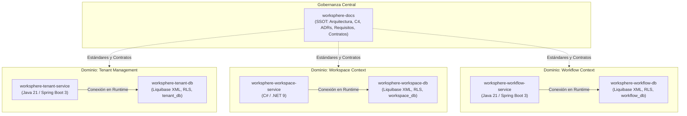
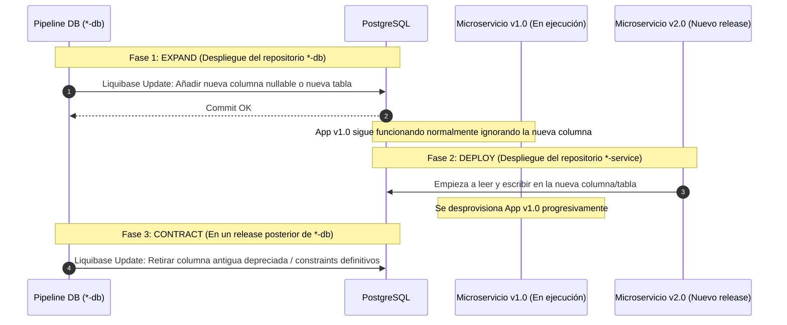

# ADR-004: Modelo Multi-Repositorio con Separación de Microservicios y Bases de Datos

- **Estado:** Propuesta (Pendiente de aprobación por Daniel / Arquitecto de Software)
- **Fecha:** 2026-11-15
- **Decisores:** Daniel (`daniel2004-lsd`)
- **Ámbito:** Toda la arquitectura de repositorios del ecosistema WorkSphere
- **Patrón de Referencia de Base de Datos:** Arquitectura Modular Liquibase (`EcoRuteandoDb`)

---

## 1. Contexto y Problema Arquitectónico

En la concepción inicial de WorkSphere se exploró un enfoque monorepo para facilitar la compilación unificada local. No obstante, al evaluar los requisitos empresariales del sistema —desarrollo políglota (Java/Spring Boot, C#/.NET 9, Go, Python), gobierno estricto de bases de datos mediante Liquibase, despliegues independientes sin tiempo de inactividad (*zero-downtime*) y asignación clara de responsabilidades entre equipos de backend y DBAs/SecOps—, el acoplamiento de código de aplicación y esquemas de persistencia en una misma unidad de control de versiones presenta fricciones estructurales.

Para resolver esto, se adopta como estándar corporativo el modelo probado en **`EcoRuteandoDb`**, donde la base de datos se estructura en capas formales SQL (`01_ddl`, `02_dml`, `03_dcl`, `05_rollbacks`) orquestadas por **Liquibase YAML Master** y ficheros `.sql` atómicos referenciados con `sqlFile`.

1. **Ciclos de vida desacoplados:** Los esquemas de base de datos evolucionan con restricciones de retrocompatibilidad más estrictas que el código de la aplicación.
2. **Estrategia Expand/Contract:** Para evitar caídas durante despliegues en producción, una modificación de esquema (añadir columnas, crear tablas, migrar datos) debe ejecutarse y verificarse en la base de datos *antes* de desplegar la versión de la aplicación que la consume.
3. **Gobierno de seguridad y RLS:** Las políticas de Row-Level Security (RLS) y permisos de PostgreSQL deben auditarse sin necesidad de clonar o revisar proyectos de código de miles de líneas en distintos lenguajes.

---

## 2. Objetivos que Motivan la Separación

- **Autonomía Operativa:** Permitir que el pipeline de migraciones de base de datos se ejecute, valide y verifique de forma totalmente independiente del ciclo de construcción (`build`/`compile`) del microservicio.
- **Trazabilidad y Auditoría de Datos:** Centralizar en repositorios específicos (`*-db`) el histórico puro de mutaciones de esquema, precondiciones, scripts de rollback y auditorías de seguridad.
- **Seguridad y Principio de Menor Privilegio:** Separar las credenciales de despliegue de base de datos (con privilegios DDL) de las credenciales de ejecución del microservicio (que solo requiere privilegios DML en tiempo de ejecución).
- **Despliegues sin Interrupción (*Zero-Downtime*):** Facilitar la orquestación formal de despliegues escalonados mediante la regla Expand/Contract.

---

## 3. Decisión Arquitectónica

Se adopta una **arquitectura multi-repositorio estricta** con segregación de responsabilidades:
1. **Un repositorio central de documentación y gobernanza:** `worksphere-docs`.
2. **Para cada microservicio:**
   - Un repositorio exclusivo para el código fuente del servicio (`worksphere-<micro>-service`).
   - Un repositorio exclusivo para su base de datos y migraciones Liquibase (`worksphere-<micro>-db`).

> [!IMPORTANT]
> **Regla General del Ecosistema:**  
> Todo nuevo microservicio que posea persistencia relacional propia tendrá asignados exactamente **dos repositorios**: uno para su código de aplicación y otro para la definición, evolución y seguridad de su base de datos.  
> No se crearán repositorios transversales (`*-infra`, `*-common`) sin un ADR específico que justifique su necesidad.

---

## 4. Topología Oficial de Repositorios (Alcance Tríada Esencial)



### Inventario de Repositorios Iniciales:

| Repositorio | Tipo | Tecnología / Stack | Responsabilidad Principal |
|---|---|---|---|
| **`worksphere-docs`** | Documental | Markdown, Mermaid | Fuente Única de Verdad (SSOT): Visión, C4, ADRs, contratos OpenAPI, esquemas CloudEvents y gobernanza. |
| **`worksphere-tenant-service`** | Servicio | Java 21 / Spring Boot 3 | API REST de gestión de organizaciones, membresías y emisor Outbox a RabbitMQ. |
| **`worksphere-tenant-db`** | Base de Datos | Liquibase XML / PostgreSQL | Changelogs, precondiciones, rollbacks, tablas `organizations`, `outbox_events` y RLS de `tenant_db`. |
| **`worksphere-workspace-service`** | Servicio | C# / ASP.NET Core (.NET 9) | Lógica de proyectos, tareas, dependencias, bloqueo por aprobación y consumidor de eventos. |
| **`worksphere-workspace-db`** | Base de Datos | Liquibase XML / PostgreSQL | Changelogs, tablas `projects`, `tasks`, `inbox_processed_events` y RLS de `workspace_db`. |
| **`worksphere-workflow-service`** | Servicio | Java 21 / Spring Boot 3 | Motor de reglas de aprobación, máquinas de estado de solicitudes y auditoría inmutable. |
| **`worksphere-workflow-db`** | Base de Datos | Liquibase XML / PostgreSQL | Changelogs, tablas `approval_requests`, `approval_audit_logs` y RLS de `workflow_db`. |

---

## 5. Responsabilidades y Límites de Cada Repositorio

### Repositorios de Base de Datos (`worksphere-*-db`):
- **Contienen:** `db.changelog-master.xml`, carpetas `changes/`, scripts SQL de precondición/rollback, definición de extensiones PostgreSQL, funciones/triggers si aplican y políticas de Row-Level Security (RLS).
- **No contienen:** Código de aplicación (Java, C#), controladores REST, entidades de ORM ni modelos de dominio.
- **Herramienta exclusiva:** CLI de Liquibase y drivers JDBC correspondientes.

### Repositorios de Microservicio (`worksphere-*-service`):
- **Contienen:** Código de backend, controladores REST, lógica de dominio (DDD), mapeadores, integración con RabbitMQ (AMQP), tests unitarios y tests de integración.
- **No contienen:** Changelogs ni scripts de creación DDL de base de datos.
- **Regla en tiempo de ejecución:** El microservicio asume que el esquema ya fue migrado y validado por el pipeline de `*-db`; su configuración de ORM (Hibernate / EF Core) opera con validación estricta (`ddl-auto=validate` o similar), prohibiendo la modificación automática de esquema desde el código.

---

## 6. Alternativas Evaluadas

| Criterio | Opción A: Monorepo Único | Opción B: Repo por Servicio con DB embebida | Opción C (Seleccionada): Separación Servicio y Base de Datos |
|---|---|---|---|
| **Aislamiento de Despliegue** | Bajo. Un cambio en un changelog dispara builds de servicios no afectados a menos que se use tooling complejo (Nx/Turborepo/Bazel). | Medio. El changelog está atado al release del servicio. | **Alto.** El esquema se despliega y prueba independientemente del runtime del servicio. |
| **Estrategia Expand/Contract** | Difícil de hacer cumplir; los desarrolladores tienden a desplegar código y BD simultáneamente. | Moderada. Requiere disciplina para no mezclar DDL destructivo con código nuevo. | **Natural.** Permite correr el pipeline de `*-db` en staging/prod horas o días antes del release de `*-service`. |
| **Complejidad de Repositorios** | 1 solo repositorio. | N repositorios (1 por servicio). | **2N + 1 repositorios** (mayor número de repos, requiere gobernanza estricta). |
| **Permisos y Seguridad** | Todos los colaboradores tienen acceso al código y a los scripts de DB. | El desarrollador del servicio gestiona la DB. | **Segregación estricta:** Equipos de infraestructura/DBA pueden gobernar `*-db` sin tocar código de backend. |

---

## 7. Estrategia de Versionamiento y Compatibilidad

Para evitar que una versión de microservicio intente interactuar con un esquema incompatible:

1. **Versionamiento Semántico Independiente (SemVer):**
   - `worksphere-tenant-db`版本: `v1.2.0`
   - `worksphere-tenant-service`版本: `v2.0.1`
2. **Matriz de Compatibilidad Documentada:**  
   Cada repositorio `*-service` declarará en su `README.md` la versión mínima requerida del esquema de base de datos:
   ```markdown
   ## Requisitos de Persistencia
   - Compatible con `worksphere-tenant-db`: >= v1.2.0, < v2.0.0
   ```
3. **Verificación en Arranque:**  
   Durante el arranque (*startup healthcheck*), el microservicio puede consultar la tabla `databasechangelog` para verificar que los changeSets críticos requeridos por sus entidades estén marcados como `EXECUTED`.

---

## 8. Estrategia Expand / Contract para Cero Tiempo de Inactividad

Ningún cambio de esquema debe romper la versión del microservicio que se encuentra actualmente en ejecución.



### Reglas Obligatorias de Expand/Contract:
- **Prohibido renombrar columnas directamente:** Se crea la nueva columna, se duplica la escritura, se migran datos históricos y luego se elimina la anterior.
- **Nuevas columnas deben ser NULLABLE o tener DEFAULT:** Una columna `NOT NULL` sin default romperá de inmediato la versión anterior del servicio que aún está insertando registros.

---

## 9. Coordinación de CI/CD y Orden de Despliegue

El orden de promoción de ambientes (`develop` → `qa` → `staging` → `main`) debe coordinarse respetando la dependencia de datos:

1. **Paso 1: Pipeline de `*-db`**
   - Ejecuta `liquibase validate` (sintaxis y consistencia de changelogs).
   - Ejecuta `liquibase updateTestingRollback` contra una base de datos efímera en el runner.
   - Aplica el cambio (`liquibase update`) en el ambiente objetivo.
2. **Paso 2: Pipeline de `*-service`**
   - Ejecuta pruebas unitarias y de integración contra el esquema ya actualizado.
   - Construye la imagen de contenedor.
   - Despliega la nueva versión del servicio en el ambiente objetivo.

---

## 10. Seguridad, Secretos y Propiedad de Datos

- **Aislamiento de Secretos en CI/CD:** Las credenciales de base de datos con permisos administrativos (DDL) residen exclusivamente en los secretos de GitHub Actions del repositorio `*-db`. El microservicio (`*-service`) solo recibe credenciales de usuario de aplicación con permisos restringidos (DML: `SELECT`, `INSERT`, `UPDATE`, `DELETE`).
- **Defensa en Profundidad:** El repositorio `*-db` es el responsable mandatorio de definir y activar las políticas de PostgreSQL Row-Level Security (RLS) en sus changeSets.

---

## 11. Consecuencias

### Positivas:
- Claridad absoluta en la propiedad de los artefactos.
- Posibilidad de realizar rollback o auditoría de base de datos sin recompilar código de aplicación.
- Equipos o desarrolladores pueden especializarse por dominio y capa (datos vs. lógica de negocio).
- Cumplimiento estricto del principio de menor privilegio en credenciales de infraestructura.

### Negativas / Costes Operativos:
- Mayor sobrecarga administrativa en GitHub (gestión de múltiples repositorios, branch protection rules y secretos independientes).
- Se requiere disciplina estricta de versionamiento y documentación de compatibilidad entre repositorios hermanos.

---

## 12. Relación con ADRs Existentes

- **Complementa a [ADR-001](./ADR-001-microservices-multitenancy.md):** Refuerza el principio de *Database per Service* al materializar la separación física de los repositorios de datos.
- **Implementa técnicamente a [ADR-002](./ADR-002-multitenancy-rls-keycloak.md):** Asigna formalmente la custodia de las políticas de PostgreSQL RLS al repositorio `*-db`.
- **Habilita a [ADR-003](./ADR-003-async-task-approval-saga.md):** Las tablas de `outbox_events` y de deduplicación idempotente (`inbox_processed_events`) se gestionan en sus respectivos repositorios `worksphere-tenant-db` y `worksphere-workspace-db`.
