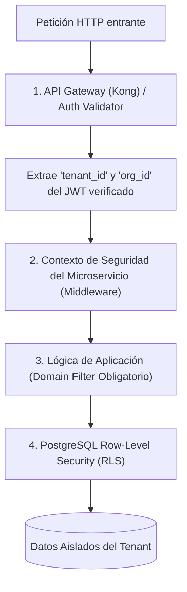

# Estrategia de Multi-Tenancy y Aislamiento de Datos

> **Documento:** ADR / Arquitectura de Aislamiento  
> **Patrón Adoptado:** Logical Separation with Database-per-Service + Row-Level Security (RLS)

---

## 🎯 Desafío del Multi-Tenancy en SaaS B2B

En **WorkSphere**, múltiples organizaciones (inquilinos) comparten la misma infraestructura de cómputo y clústeres de base de datos. Bajo ninguna circunstancia los datos de una empresa (`tenant-A`) pueden ser visibles ni modificados por usuarios de otra empresa (`tenant-B`).

---

## 🛡️ Niveles de Aislamiento en Capas (Defensa en Profundidad)



### Capa 1: Contexto Criptográfico en JWT (Keycloak)
El token JWT emitido por Keycloak al autenticarse un usuario contiene los claims:
```json
{
  "sub": "usr_99812",
  "email": "carlos@techsolutions.com",
  "tenant_id": "ten_techsolutions_01",
  "roles": ["workspace_admin", "project_manager"]
}
```
El Gateway valida la firma criptográfica y rechaza cualquier solicitud sin tenant válido.

### Capa 2: Filtro de Dominio y Query Enforcers
En cada microservicio (Spring Boot / .NET / FastAPI), todo repositorio y handler inyecta el `tenant_id` del contexto actual. Ningún query `SELECT`, `UPDATE` o `DELETE` se genera sin la cláusula:
```sql
WHERE tenant_id = :current_tenant_id
```

### Capa 3: PostgreSQL Row-Level Security (RLS)
Como defensa a nivel de base de datos contra errores de código o inyecciones SQL, todas las tablas de negocio activan RLS:

```sql
-- Ejemplo en workspace_db
ALTER TABLE projects ENABLE ROW LEVEL SECURITY;

CREATE POLICY tenant_isolation_policy ON projects
    FOR ALL
    TO app_user
    USING (tenant_id = current_setting('app.current_tenant_id', true));
```

Antes de ejecutar cualquier query en la conexión del pool:
```sql
SET LOCAL app.current_tenant_id = 'ten_techsolutions_01';
```
Si el código accidentalmente omite el filtro en el query, PostgreSQL bloqueará cualquier fila que no corresponda al inquilino establecido en la sesión.

---

## 🧪 Pruebas Automatizadas de Aislamiento (Tenant Leakage Tests)

Cada microservicio incluirá una suite de pruebas de integración específica:
1. Crear dos inquilinos (`tenant-1` y `tenant-2`).
2. Insertar registros en nombre de `tenant-1`.
3. Ejecutar consultas autenticado como `tenant-2`.
4. El test falla si se devuelve `200 OK` con registros ajenos; debe retornar `404 Not Found` o lista vacía.
