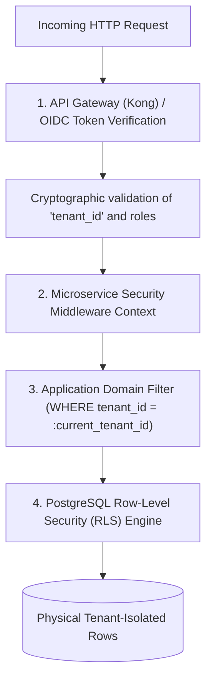

# 05 — Multi-Tenancy Strategy & Data Isolation

> **Document:** Architecture Decision & Isolation Design  
> **Pattern:** Logical Isolation with Database-per-Service + PostgreSQL Row-Level Security (RLS)  
> **Status:** 🟢 Baseline  
> **Technical Lead & Architect:** Daniel (`daniel2004-lsd`)  
> **Project:** WorkSphere — Enterprise Operations Intelligence Platform

---

## 🎯 The Multi-Tenancy Challenge in Enterprise B2B SaaS

In WorkSphere, multiple customer organizations (tenants) share common compute and database cluster infrastructure (*Shared Database, Shared Schema per microservice*).

Under zero circumstances may data belonging to Company A (`tenant-A`) be viewed, queried, or modified by users belonging to Company B (`tenant-B`).

---

## 🛡️ Defense-in-Depth Layered Isolation

WorkSphere enforces tenant isolation across four independent architectural boundaries:



### Layer 1: Cryptographic JWT Context (Keycloak OIDC)
Tokens issued upon user authentication contain immutable claims:
```json
{
  "sub": "usr_99812",
  "email": "carlos@techsolutions.com",
  "tenant_id": "ten_techsolutions_15d1e947",
  "organization_slug": "techsolutions",
  "roles": ["workspace_admin", "project_manager"]
}
```
The API Gateway and services **reject any request** attempting to supply a `tenant_id` via query parameters or body payloads. The tenant context is extracted strictly from the verified cryptographic token signature.

### Layer 2: Security Middleware & Connection Context Injection
Before any database query is executed, the microservice middleware sets a PostgreSQL session-level variable on the leased connection:
```sql
SET LOCAL app.current_tenant_id = 'ten_techsolutions_15d1e947';
```

### Layer 3: Application Domain Query Enforcers
All ORM repositories (JPA / Entity Framework Core) automatically inject `tenant_id` into `SELECT`, `UPDATE`, and `DELETE` predicates as standard practice.

### Layer 4: PostgreSQL Row-Level Security (Engine Defense)
As a physical fail-safe against software bugs or SQL injection vulnerabilities, all tenant-owned tables enforce RLS:

```sql
ALTER TABLE projects ENABLE ROW LEVEL SECURITY;

CREATE POLICY tenant_isolation_policy ON projects
    FOR ALL
    TO PUBLIC
    USING (
        tenant_id = current_setting('app.current_tenant_id', true)
        OR current_setting('app.current_tenant_id', true) = 'SYSTEM'
    );
```

If an application query inadvertently omits a `WHERE` clause, PostgreSQL physically blocks reading or writing any row whose `tenant_id` does not match the active session variable.

---

## 🧪 Automated Tenant Leakage Testing Mandate

Every microservice must implement an automated integration test suite specifically designed to verify isolation:
1. Seed test records under `tenant-1`.
2. Execute queries and mutations authenticated as `tenant-2`.
3. The test fails if any record from `tenant-1` is accessible; the API must return `404 Not Found` or an empty list.
