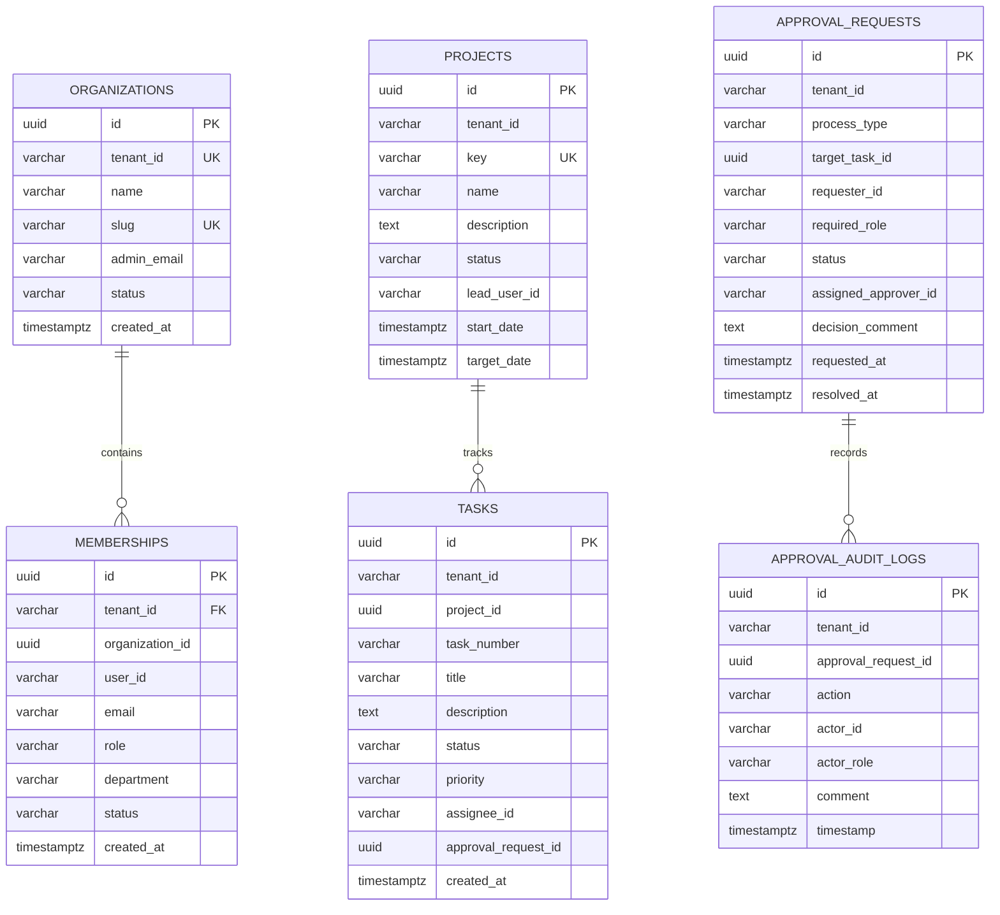

# 06 — Data Models & Relational Entity Dictionaries (MVP Triad)

> **Document:** Enterprise Data Models & Entity Relationships  
> **Status:** 🟢 Baseline  
> **Technical Lead & Architect:** Daniel (`daniel2004-lsd`)  
> **Project:** WorkSphere — Enterprise Operations Intelligence Platform  
> **Engine:** PostgreSQL 16 (Database per Service)  
> **Governance:** Liquibase YAML Master + SQL Modules + PostgreSQL Row-Level Security (RLS)

---

## 🏛️ Persisted Bounded Context Topologies

> [!IMPORTANT]
> **No Inter-Database Foreign Keys:**  
> `PROJECTS` and `APPROVAL_REQUESTS` reside in separate physical database instances (`workspace_db` and `workflow_db`).  
> The relationship between `TASKS.approval_request_id` and `APPROVAL_REQUESTS.id` is strictly **logical**, synchronized via CloudEvents over RabbitMQ and verified against the authenticated `tenant_id`.

---

## 1. Schema `tenant_db` (Tenant Management Service)

### 1.1. Table: `organizations`
- `id` (UUID, PK, Default `gen_random_uuid()`): Internal entity identifier.
- `tenant_id` (VARCHAR(64), UNIQUE, NOT NULL): Canonical multi-tenant partition key (e.g., `ten_techsolutions_15d1e947`).
- `name` (VARCHAR(120), NOT NULL): Registered corporate name.
- `slug` (VARCHAR(64), UNIQUE, NOT NULL): Normalized URL slug.
- `admin_email` (VARCHAR(120), NOT NULL): Primary administrative contact.
- `status` (VARCHAR(30), NOT NULL, Default `'ACTIVE'`): `ACTIVE`, `SUSPENDED`, `DELETED`.
- `created_at`, `updated_at` (TIMESTAMPTZ, NOT NULL).

### 1.2. Table: `memberships`
- `id` (UUID, PK).
- `tenant_id` (VARCHAR(64), NOT NULL, Indexed): Tenant isolation partition key.
- `organization_id` (UUID, NOT NULL, FK to `organizations.id`).
- `user_id` (VARCHAR(64), NOT NULL): Keycloak user identity subject (`sub`).
- `email` (VARCHAR(120), NOT NULL).
- `role` (VARCHAR(40), NOT NULL): `TENANT_ADMIN`, `PROJECT_MANAGER`, `APPROVER`, `ENGINEER`.
- `department` (VARCHAR(60)): e.g., "Engineering", "Operations", "Finance".
- `status` (VARCHAR(30), NOT NULL): `ACTIVE`, `INVITED`, `REVOKED`.

---

## 2. Schema `workspace_db` (Workspace Service — .NET 9)

### 2.1. Table: `projects`
- `id` (UUID, PK).
- `tenant_id` (VARCHAR(64), NOT NULL, Indexed): Tenant isolation key.
- `key` (VARCHAR(10), NOT NULL): Project prefix code (e.g., `WKS`, `ALPHA`).
- `name` (VARCHAR(120), NOT NULL).
- `description` (TEXT).
- `status` (VARCHAR(30), NOT NULL): `PLANNING`, `ACTIVE`, `ON_HOLD`, `COMPLETED`.
- `lead_user_id` (VARCHAR(64), NOT NULL): Assigned project delivery lead.
- `created_at` (TIMESTAMPTZ, NOT NULL).

### 2.2. Table: `tasks`
- `id` (UUID, PK).
- `tenant_id` (VARCHAR(64), NOT NULL, Indexed): Tenant isolation key.
- `project_id` (UUID, NOT NULL, FK to `projects.id`).
- `task_number` (VARCHAR(20), NOT NULL): e.g., `WKS-104`.
- `title` (VARCHAR(150), NOT NULL).
- `description` (TEXT).
- `status` (VARCHAR(30), NOT NULL): `TODO`, `IN_PROGRESS`, `BLOCKED_BY_APPROVAL`, `READY_FOR_REVIEW`, `DONE`.
- `priority` (VARCHAR(20), NOT NULL): `LOW`, `MEDIUM`, `HIGH`, `CRITICAL`.
- `assignee_id` (VARCHAR(64)): Assigned engineer user ID.
- `approval_request_id` (UUID): Foreign logical reference to `approval_requests.id` in `workflow_db`.
- `created_at`, `updated_at` (TIMESTAMPTZ, NOT NULL).

---

## 3. Schema `workflow_db` (Workflow Service — Spring Boot 3)

### 3.1. Table: `approval_requests`
- `id` (UUID, PK).
- `tenant_id` (VARCHAR(64), NOT NULL, Indexed): Tenant isolation key.
- `process_type` (VARCHAR(50), NOT NULL): `BUDGET_APPROVAL`, `SCOPE_CHANGE`, `RESOURCE_ALLOCATION`, `TECH_VALIDATION`.
- `target_task_id` (UUID, NOT NULL): Logical reference to task in `workspace_db`.
- `requester_id` (VARCHAR(64), NOT NULL): User initiating the request.
- `required_role` (VARCHAR(40), NOT NULL): e.g., `APPROVER`, `TENANT_ADMIN`.
- `status` (VARCHAR(30), NOT NULL): `PENDING`, `APPROVED`, `REJECTED`, `CANCELLED`.
- `assigned_approver_id` (VARCHAR(64)): Specific approver if delegated.
- `decision_comment` (TEXT): Mandatory justification submitted upon decision.
- `requested_at` (TIMESTAMPTZ, NOT NULL).
- `resolved_at` (TIMESTAMPTZ): Final decision timestamp.

### 3.2. Table: `approval_audit_logs` (Immutable Decision Trail)
- `id` (UUID, PK).
- `tenant_id` (VARCHAR(64), NOT NULL).
- `approval_request_id` (UUID, NOT NULL, FK to `approval_requests.id`).
- `action` (VARCHAR(30), NOT NULL): `SUBMITTED`, `ASSIGNED`, `APPROVED`, `REJECTED`.
- `actor_id` (VARCHAR(64), NOT NULL).
- `actor_role` (VARCHAR(40), NOT NULL).
- `comment` (TEXT).
- `timestamp` (TIMESTAMPTZ, NOT NULL, Default `NOW()`).
