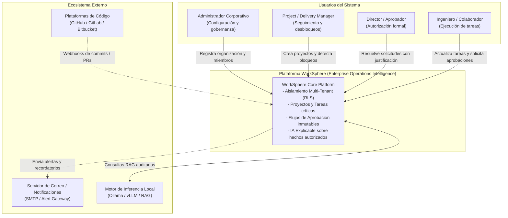
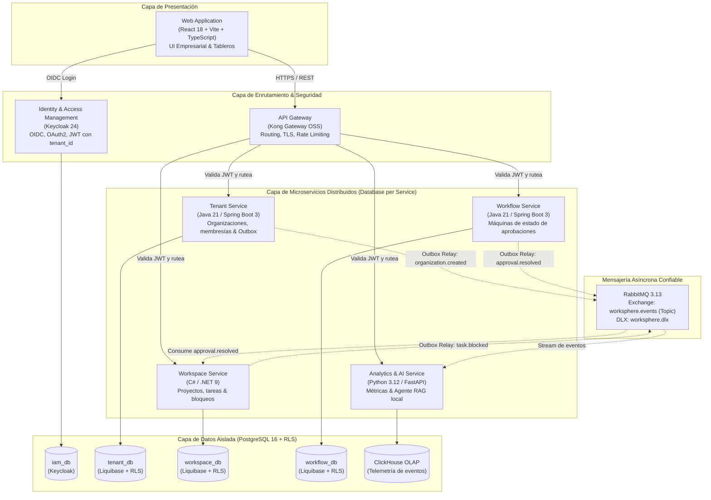

# 08 — Diagramas de Arquitectura C4 (Nivel 1 y Nivel 2)

> **Documento:** C4 Model System Architecture  
> **Estado:** 🟢 Estable (Fase 0)  
> **Líder Técnico & Arquitecto:** Daniel (`daniel2004-lsd`)  
> **Proyecto:** WorkSphere — Enterprise Operations Intelligence Platform

---

## 1. Diagrama C4 Nivel 1: Contexto del Sistema (System Context)

El Diagrama de Contexto muestra a **WorkSphere** en el centro, los diferentes usuarios empresariales que interactúan con él y los sistemas externos con los que se integra o relaciona.

---

## 2. Diagrama C4 Nivel 2: Contenedores (Container Diagram)

El Diagrama de Contenedores descompone **WorkSphere** en sus aplicaciones web, pasarela de entrada (Gateway), microservicios independientes, bases de datos aisladas y el broker de mensajería asíncrono.

---

## 3. Justificación de los Límites de Red y Aislamiento

1. **Punto Único de Ingress:** Todo el tráfico externo entra exclusivamente por el **Kong Gateway** (puerto `8000/8005`). Ningún microservicio ni base de datos expone sus puertos directamente hacia clientes de internet.
2. **Database-per-Service Estricto:** Cada microservicio se conecta única y exclusivamente a su propia base de datos mediante credenciales aisladas. No existen *cross-database foreign keys*.
3. **Desacoplamiento Asíncrono de Desbloqueo:** Cuando el `Workflow Service` resuelve una aprobación, no invoca sincrónicamente al `Workspace Service` mediante HTTP (lo cual crearía acoplamiento temporal y riesgo de cascada de fallos). En su lugar, confirma la decisión en su base de datos, escribe en su tabla outbox y emite el evento `approval.resolved` a RabbitMQ; el `Workspace Service` consume el evento y desbloquea la tarea de forma idempotente.
