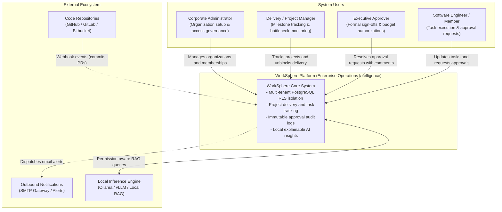
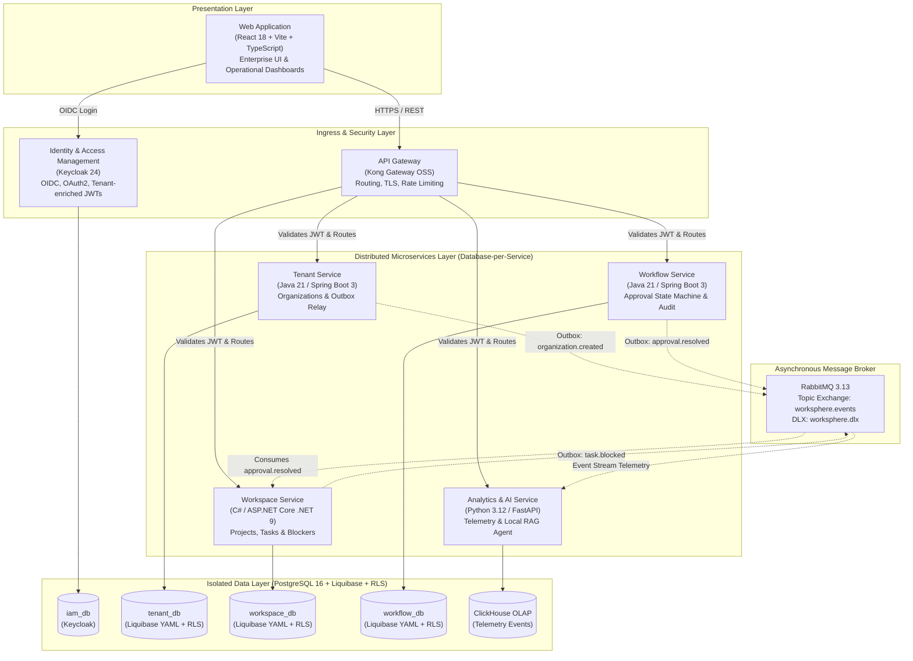

# 08 — C4 Architecture Diagrams (Level 1 & Level 2)

> **Document:** C4 Model System Architecture  
> **Status:** 🟢 Baseline  
> **Technical Lead & Architect:** Daniel (`daniel2004-lsd`)  
> **Project:** WorkSphere — Enterprise Operations Intelligence Platform

---

## 1. C4 Level 1: System Context Diagram

The System Context diagram illustrates **WorkSphere** at the center, its enterprise user personas, and external supporting systems.

---

## 2. C4 Level 2: Container Diagram

The Container diagram decomposes **WorkSphere** into client applications, security ingress, distributed microservices, independent databases, and asynchronous message brokers.

---

## 3. Network Boundaries & Operational Security Rules

1. **Single Public Ingress:** All external client traffic terminates at **Kong API Gateway**. Microservices, databases, and message brokers are isolated within private Docker bridge / Kubernetes networks.
2. **Database Isolation:** Microservices communicate exclusively over documented contracts; direct cross-database queries are strictly blocked.
3. **Asynchronous Task Unblocking:** `Workflow Service` never calls `Workspace Service` over synchronous HTTP upon approval completion. State changes are communicated via RabbitMQ events backed by the Transactional Outbox pattern.
