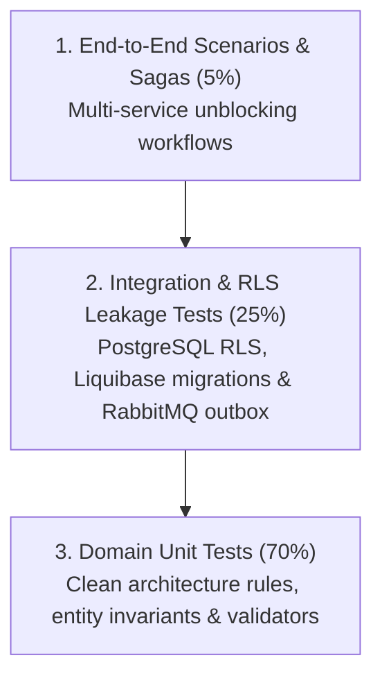

# 11 — Quality Assurance, Testing Strategy & Verification Standards

> **Document:** Enterprise Quality Engineering & Test Standards  
> **Status:** 🟢 Baseline  
> **Technical Lead & Architect:** Daniel (`daniel2004-lsd`)  
> **Project:** WorkSphere — Enterprise Operations Intelligence Platform

---

## 1. Testing Pyramid

WorkSphere enforces a balanced test pyramid where every layer delivers verifiable evidence:



---

## 2. Testing Levels and Verification Rules

### 2.1. Domain Unit Tests (Mandatory Coverage: > 80%)
- Tests business entity state machines, domain invariants, and DTO validations.
- Runs entirely in-memory without external database or broker dependencies.

### 2.2. Multi-Tenant Leakage Tests (Non-Negotiable)
Every microservice interacting with a database must include explicit cross-tenant isolation suites:
```java
// Conceptual example in tenant-service integration test
@Test
void userFromTenantB_cannotAccessTenantA_records() {
    // 1. Seed organization for Tenant A
    Organization orgA = createOrg("Tenant A", "tenant-a");
    
    // 2. Set security context to Tenant B
    SecurityContext.setTenantId("tenant-b");
    
    // 3. Attempt query
    Optional<Organization> result = orgRepository.findByTenantId(orgA.getTenantId());
    
    // 4. Assert PostgreSQL RLS physically filtered the row
    assertThat(result).isEmpty();
}
```

### 2.3. Liquibase Migration & Rollback Tests (In `*-db` Pipelines)
- **Fresh Install Test:** Validates that `db.changelog-master.yaml` deploys successfully on a clean database.
- **Rollback Test:** Executes `liquibase updateTestingRollback` to ensure every changeset is safely reversible.

---

## 3. Definition of Test Verification Honest Conduct

As defined in the project constitution:
- **No Test Passing Claims Without Shell Output:** An agent or engineer must never state that a test passed without running the build/test CLI tool and capturing raw logs.
- **No Spec Modification to Hide Defects:** Specifications must never be altered to accommodate failing tests.
