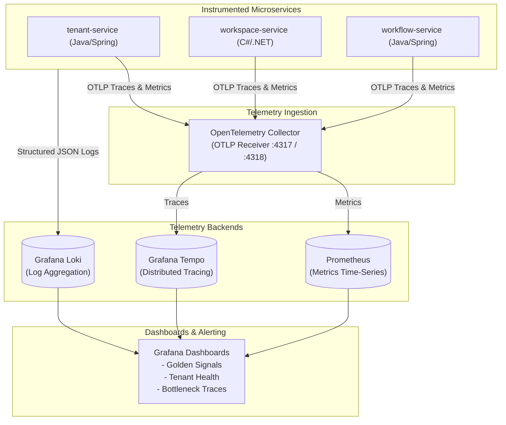

# 13 — Distributed Observability, Telemetry & Operations

> **Document:** Monitoring, Distributed Tracing & Logging Standards  
> **Status:** 🟢 Baseline  
> **Technical Lead & Architect:** Daniel (`daniel2004-lsd`)  
> **Project:** WorkSphere — Enterprise Operations Intelligence Platform  
> **Stack:** OpenTelemetry, Prometheus, Grafana, Loki, Tempo

---

## 1. Observability Architecture

In an event-driven microservices architecture, visibility requires correlating logs, metrics, and traces across service and asynchronous broker boundaries.



---

## 2. Distributed Tracing & W3C Context Propagation

### 2.1. Synchronous REST Calls
Every incoming HTTP request passing through Kong Gateway receives or forwards the standard W3C header:
```http
traceparent: 00-4bf92f3577b34da6a3ce929d0e0e4736-00f067aa0ba902b7-01
```

### 2.2. Asynchronous RabbitMQ Events
When publishing an event via the Transactional Outbox, the relay injects the active trace context into the RabbitMQ message headers:
```json
{
  "headers": {
    "traceparent": "00-4bf92f3577b34da6a3ce929d0e0e4736-00f067aa0ba902b7-01",
    "x-tenant-id": "ten_techsolutions_15d1e947"
  }
}
```
Consumers extract this header, linking the task unblocking span directly to the original approval resolution span in Grafana Tempo.

---

## 3. Four Golden Signals (Metrics Monitoring)

Each microservice exports standard Prometheus metrics scraped every 15 seconds:

1. **Latency:** Request duration histograms (`http_server_requests_seconds_bucket`).
2. **Traffic:** Request rate counter per route and HTTP status (`http_server_requests_total`).
3. **Errors:** Count of 5xx HTTP responses and unhandled exceptions (`http_server_exceptions_total`).
4. **Saturation:** Database connection pool utilization (HikariCP active connections / EF Core connection count) and CPU/Memory limits.

---

## 4. Structured JSON Logging

All microservices must output logs strictly to `stdout` in structured JSON format for Loki consumption:

```json
{
  "timestamp": "2026-11-15T21:28:00.124Z",
  "level": "INFO",
  "service": "workflow-service",
  "tenant_id": "ten_techsolutions_15d1e947",
  "trace_id": "4bf92f3577b34da6a3ce929d0e0e4736",
  "span_id": "00f067aa0ba902b7",
  "message": "Approval request 9a2f1b40 resolved with decision APPROVED",
  "details": {
    "approval_id": "9a2f1b40-2c71-482f-857c-f823a0198f92",
    "target_task_id": "101e9f24-3a1b-4ea5-a36f-b9fbbc66e46a",
    "approver_id": "usr_maria_directora"
  }
}
```
> [!CAUTION]
> Logs must **never contain plaintext passwords, personal identification numbers, JWT secrets, or raw bearer tokens**.
