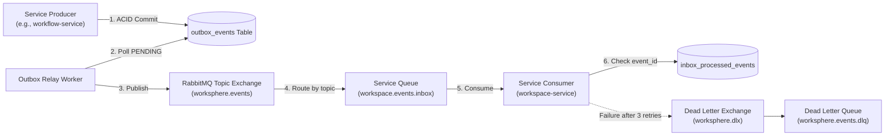

# 14 — Event Catalog, Asynchronous Messaging & Dead Letter Queue Governance

> **Broker:** RabbitMQ 3.13  
> **Exchange Strategy:** Topic Exchanges (`worksphere.events`) + Direct DLX (`worksphere.dlx`)  
> **Standard:** CloudEvents v1.0 JSON Specification  
> **Patterns:** Transactional Outbox, Consumer Idempotency, Exponential Backoff Retries

---

## 1. Asynchronous Architecture & Reliable Delivery

WorkSphere relies on asynchronous messaging to decouple state transitions across microservices without synchronous HTTP blocking.

---

## 2. Event Routing Topologies

- **Primary Exchange:** `worksphere.events` (Type: `topic`, Durable: `true`)
- **Dead Letter Exchange:** `worksphere.dlx` (Type: `direct`, Durable: `true`)
- **Dead Letter Queue:** `worksphere.events.dlq` (Bound to `worksphere.dlx` with routing key `dead-letter`)

### Routing Key Standard:
Format: `worksphere.<domain>.<entity>.<action>`

| Routing Key | Producing Service | Consuming Services | Description |
|---|---|---|---|
| `worksphere.tenant.organization.created` | `tenant-service` | Billing, Notifications, Analytics | Emitted when an organization completes onboarding. |
| `worksphere.workspace.task.blocked` | `workspace-service` | Workflow, Notifications | Emitted when a task enters `BLOCKED_BY_APPROVAL`. |
| `worksphere.workflow.approval.resolved` | `workflow-service` | `workspace-service`, Notifications | Emitted when a decision (`APPROVED`/`REJECTED`) is recorded. |

---

## 3. Resiliency, Retries & Dead Letter Policies

1. **Consumer Idempotency:**  
   Every consumer records the CloudEvents `id` in its local `inbox_processed_events` table within the same transaction that applies the state change. If an event is redelivered, the consumer acknowledges immediately without re-executing logic.
2. **Retry Strategy:**  
   - Attempt 1: Immediate retry.
   - Attempt 2: 2-second backoff.
   - Attempt 3: 10-second backoff.
   - Failure: Negative Acknowledgement (`basic.reject(requeue=false)`), automatically routing the message to `worksphere.dlx`.
