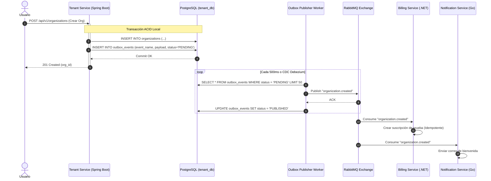

# 14 — Catálogo de Eventos y Mensajería Asíncrona (RabbitMQ)

> **Broker:** RabbitMQ  
> **Patrones:** Transactional Outbox, Competing Consumers, Dead Letter Exchange (DLX), Idempotency Key  
> **Estándar:** CloudEvents v1.0 Spec

---

## 📬 Arquitectura de Publicación: Transactional Outbox Pattern

Para garantizar que un evento **nunca se pierda** si el broker se cae o si falla la red, los microservicios no publican directamente a RabbitMQ durante la transacción web.

---

## 📜 Catálogo Inicial de Eventos

| Evento | Origen (Producer) | Destinos (Consumers) | Carga Útil (Payload Resumen) |
|---|---|---|---|
| `organization.created` | Tenant Management | Billing, Notifications, Analytics | `tenant_id`, `org_name`, `admin_email`, `created_at` |
| `member.invited` | Tenant Management | Notifications | `tenant_id`, `invitation_id`, `target_email`, `role`, `expires_at` |
| `subscription.activated` | Billing Service | Tenant Management, Notifications | `tenant_id`, `plan_id`, `max_users`, `max_storage_gb`, `status` |
| `subscription.suspended` | Billing Service | Tenant Management, Notifications | `tenant_id`, `reason`, `suspended_at` |
| `task.created` | Workspace Service | Workflow, Analytics | `tenant_id`, `project_id`, `task_id`, `assigned_to`, `priority` |
| `task.status_changed` | Workspace Service | Workflow, Notifications | `tenant_id`, `task_id`, `previous_status`, `new_status`, `changed_by` |
| `approval.requested` | Workflow Service | Notifications, Workspace | `tenant_id`, `workflow_id`, `approver_id`, `entity_type`, `entity_id` |

---

## 🛡️ Políticas de Resiliencia en RabbitMQ

1. **Dead Letter Exchange (DLX):** Si un mensaje falla tras 3 reintentos con *exponential backoff*, se enruta a la cola `.dlq` para inspección humana o reprocesamiento sin bloquear el flujo.
2. **Idempotencia:** Cada consumidor almacena en una tabla `processed_events` el `event_id` (UUID único del evento). Si recibe un mensaje duplicado, lo ignora y emite ACK inmediatamente.
