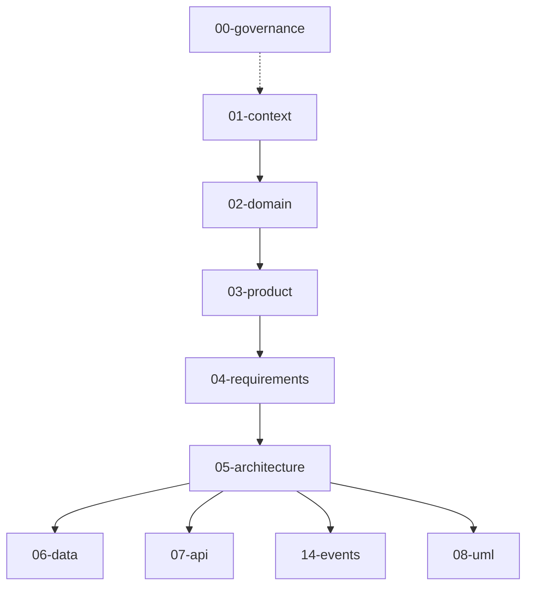

# WorkSphere — Single Source of Truth (SSOT) & Technical Governance

> Official repository for **Software Design Documentation (SDD)**, architectural governance, and system specifications for the **WorkSphere Enterprise Operations Intelligence Platform**.

---

## 🎯 What is WorkSphere?

**WorkSphere** is an enterprise-grade B2B Multi-Tenant SaaS platform designed to eliminate operational context blindness in knowledge-intensive firms (such as software consultancies and professional service agencies).

Unlike traditional task managers that operate as isolated silos, WorkSphere connects the **organizational structure**, **approval workflows**, and **project deliverables** into a unified, auditable operational graph with real-time bottleneck detection and explainable local AI assistance.

---

## 🏛️ Core Architectural Principles (Non-Negotiable)

1. **Strict Repository Separation:**  
   - `worksphere-docs`: Exclusively for architecture, requirements, contracts, and governance. No source code.  
   - `worksphere-*-service`: Application source code only.  
   - `worksphere-*-db`: Liquibase declarative migrations and PostgreSQL policies only.
2. **Database per Service:** Every service has exclusive ownership of its data store. Cross-database queries or shared foreign keys are strictly prohibited.
3. **Multi-Tenancy Defense-in-Depth:** Every business table is partitioned by `tenant_id` and protected at the database engine level via **PostgreSQL Row-Level Security (RLS)**.
4. **Asynchronous Orchestration via Outbox:** Inter-service coordination (such as unblocking tasks after approval) is handled asynchronously via RabbitMQ and the **Transactional Outbox Pattern**.
5. **Universal Language Mandate:** All documentation, contracts, code comments, and ADRs are maintained **100% in professional English**.
6. **Local-Only SDD & AI Workspaces:** Local tool configurations (`.specify/`, `.codex/`, `.claude/`, `.antigravity/`) and environment secrets are blacklisted from Git repositories.

---

## 🗺️ Documentation Dependency Map (SDD Framework)

---

## 📚 Section Directory

| Section | Scope and Core Responsibility |
|---|---|
| [`00-governance/`](./00-governance/README.md) | Branching strategy, DoR, DoD, agile conventions, secret hygiene, and repository separation. |
| [`01-context/`](./01-context/problem-framing.md) | Problem statement, operational context blindness, and system justification. |
| [`02-domain/`](./02-domain/domain-map.md) | Bounded contexts, domain boundaries, and polyglot technology mapping. |
| [`03-product/`](./03-product/vision.md) | Product vision, three pillars of value, and prioritized product backlog (`EPC-01` to `EPC-04`). |
| [`04-requirements/`](./04-requirements/user-stories.md) | Functional requirements, Gherkin acceptance criteria, and traceability matrix. |
| [`05-architecture/`](./05-architecture/README.md) | C4 architecture models, multi-tenancy strategy, and Architecture Decision Records (ADRs). |
| [`06-data/`](./06-data/data-models.md) | Domain ERDs, data dictionaries, and canonical Liquibase standards (`01_ddl` to `05_rollbacks`). |
| [`07-api/`](./07-api/contracts/) | OpenAPI 3.0 formal specifications for Gateway, Workspace, and Workflow APIs. |
| [`08-uml/`](./08-uml/c4-architecture-diagrams.md) | C4 Context (Level 1) and Container (Level 2) system diagrams. |
| [`14-events/`](./14-events/contracts/) | CloudEvents v1.0 specifications, RabbitMQ topic exchanges, and DLQ policies. |
