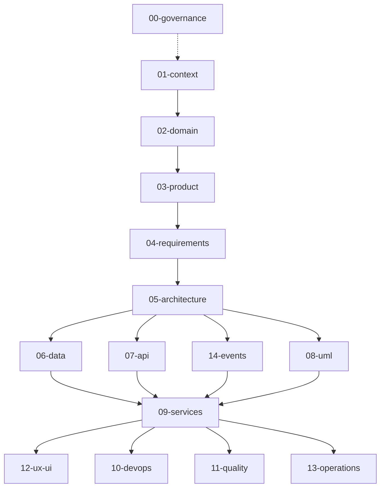

# WorkSphere — Fuente Única de Verdad (SSOT) & Architecture Governance

> Repositorio oficial de **Documentación de Diseño de Software (SDD)** y Gobernanza Técnica para la plataforma empresarial SaaS Multi-Tenant **WorkSphere**.

---

## 🎯 ¿Qué es WorkSphere?

**WorkSphere** es una plataforma SaaS B2B empresarial multi-inquilino (*multi-tenant*) diseñada para permitir a distintas organizaciones gestionar sus equipos, espacios de trabajo, tareas, flujos de aprobación y procesos de negocio, suscripciones y métricas de analítica desde un entorno unificado, con estricto aislamiento lógico de datos y arquitectura distribuida orientada a eventos.

---

## 🏛️ Principios y Reglas de Oro de la Arquitectura

1. **Database per Service:** Cada microservicio es dueño absoluto de su persistencia. Ningún servicio consulta ni modifica directamente la base de datos de otro.
2. **Event-Driven & Eventual Consistency:** Comunicación asíncrona respaldada por RabbitMQ para desacoplar operaciones complejas.
3. **Transactional Outbox Pattern:** Cero pérdida de eventos entre el commit a base de datos y la publicación en el broker.
4. **Idempotencia Obligatoria:** Los consumidores de eventos y operaciones críticas de pago o aprovisionamiento deben tolerar duplicados mediante claves de idempotencia.
5. **Aislamiento Multi-Tenant de Primer Nivel:** Cada entidad de negocio pertenece a un `tenant_id`. Defensa en profundidad con Row-Level Security (RLS) en PostgreSQL y filtros a nivel de dominio.
6. **Diseño Guiado por el Dominio (DDD):** Límites claros (*Bounded Contexts*) y Clean Architecture en servicios empresariales.

---

## 🗺️ Mapa de Dependencias de Documentación (SDD Framework)

---

## 📚 Estructura de las Secciones

| Sección | Responsabilidad y Pregunta Clave |
|---|---|
| [`00-governance/`](./00-governance/README.md) | ¿Cómo planifica, versiona, revisa y aprueba el equipo el trabajo técnico? |
| [`01-context/`](./01-context/README.md) | ¿Por qué existe WorkSphere, a quién sirve y cuáles son sus límites de sistema? |
| [`02-domain/`](./02-domain/README.md) | ¿Cuáles son los Bounded Contexts y cómo interactúan los conceptos de negocio? |
| [`03-product/`](./03-product/README.md) | Visión del producto, propuesta de valor B2B y modelos de monetización SaaS. |
| [`04-requirements/`](./04-requirements/README.md) | Requerimientos funcionales (SRS, HU) y no funcionales (SLAs, aislamiento, rendimiento). |
| [`05-architecture/`](./05-architecture/README.md) | C4 Model, microservicios, Outbox, Saga, aislamiento multi-tenant y ADRs. |
| [`06-data/`](./06-data/README.md) | Estrategia de bases de datos por servicio, esquemas, migraciones y RLS. |
| [`07-api/`](./07-api/README.md) | API Gateway (Kong), contratos REST / OpenAPI y políticas de enrutamiento. |
| [`08-uml/`](./08-uml/README.md) | Diagramas de secuencia distribuida, C4 contenedores y diagramas de estados. |
| [`09-services/`](./09-services/README.md) | Especificación individual de los 8 microservicios de la plataforma. |
| [`10-devops/`](./10-devops/README.md) | Docker Compose para desarrollo local, redes, variables de entorno y CI/CD. |
| [`11-quality/`](./11-quality/README.md) | Pruebas de integración, aislamiento entre tenants, contratos y carga. |
| [`12-ux-ui/`](./12-ux-ui/README.md) | Design System web empresarial (React + TS + Tailwind), vistas clave y flujos UX. |
| [`13-operations/`](./13-operations/README.md) | Observabilidad (Prometheus, Grafana, OpenTelemetry, Loki), alertas y runbooks. |
| [`14-events/`](./14-events/README.md) | Catálogo de eventos asíncronos en RabbitMQ, esquemas CloudEvents y DLQ. |

---

## 🚀 Metodología de Trabajo

1. Consulta [`00-sdd-guide.md`](./00-sdd-guide.md) para conocer las fases del proyecto y los gates de aprobación.
2. Todo cambio arquitectónico se debate y documenta en un **ADR (Architecture Decision Record)** dentro de `05-architecture/decisions/` antes de codificarlo.
3. Principio de **Living Documentation**: los contratos y documentación evolucionan junto al código.
